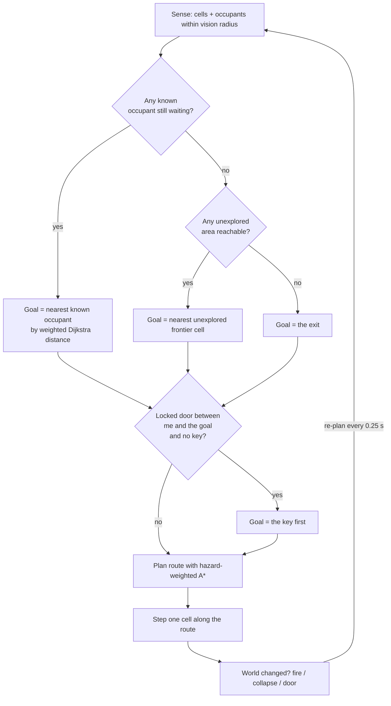

# CT3201 Mini Project — Project Report

**Project:** *Pyro Pete: Emergency Evacuation* — an evacuation‑routing AI agent
**Problem area:** search / intelligent agent / decision‑making under uncertainty

> **How to use this file.** It's a first draft covering all 9 slide sections
> plus the phase work. Everything is written from the game as it stands and
> from the AI‑assisted work recorded in `docs/ai_critique.md`,
> `docs/search_comparison.md` and the team's Claude Code history.
> **`[TEAM]`** marks a spot where you must confirm, correct, or add from
> your own experience — especially Section 8 (reflection), which the brief
> grades on *your* judgement, not a draft's.

---

## Section 1 — Problem Definition  *(Phase 1, Stage 1 — done human‑first, before AI)*

**Problem.** When a building is on fire, occupants who don't know the layout
must be found and led to an exit before fire, smoke and structural collapse
cut the route off. A rescuer has to decide, moment to moment and with
incomplete information, **who to go to next and by what route** as conditions
change.

**User.** `[TEAM: pick the one you actually intended]` — e.g. fire‑service
route planners evaluating building layouts; a training simulator for
rescuers; or a decision‑support tool that suggests a route to a rescuer in
the field.

**Environment.** A multi‑room floor plan modelled as a grid of connected
cells (the course's "floor plan as a graph"). Hazards evolve over time:
fire spreads from an ignition point, smoke thickens around it, electrical
panels arc, and the ceiling collapses in places. One internal door is
locked and needs a key found elsewhere. The rescuer can only see a small
radius around themselves — the rest of the building is unknown until
visited.

**Desired outcome.** All reachable occupants led out through the exit, then
the rescuer out too — as fast as possible and with as little exposure to
hazards as possible.

**Main decision.** *Given what I currently know, do I push deeper for
another occupant, or take the ones I have and get out now?* — a trade‑off
between more rescues (reward) and time / health / the risk of losing
everyone if the rescuer dies on the way back.

**"Think first" note.** `[TEAM]` — one or two lines confirming you defined
the above before opening any AI tool, and roughly what your first sketch
looked like (Stage 1 requires this).

---

## Section 2 — Initial Human Solution  *(Phase 1, Stage 2 — the AI formulation)*

We formulated the rescuer as a **goal‑based agent doing graph search over a
grid**, with hazards as costs rather than as walls where possible.

| Element | Our project |
|---|---|
| **Agent** | one autonomous rescue unit (in‑game: the drone; the human plays the same role) |
| **State** | current cell · set of occupants and their status (waiting / following / out) · the part of the map seen so far · current health |
| **Actions** | move to one of the four adjacent floor cells |
| **Goal** | lead every reachable occupant to the exit, then reach the exit |
| **Transition** | deterministic movement; the *world* is non‑stationary — fire spreads, tiles collapse, the door unlocks |
| **Cost** | 1 per step, plus a hazard surcharge for the entered cell: fire +8, smoke +2 × density, sparking panel +7.5, a tile that is visibly about to collapse +25 |
| **Constraints** | walls and fallen debris are impassable; the locked door is impassable until the key is picked up; health drains while standing in a hazard and reaching 0 ends the run |
| **Information** | **partial** — only cells and occupants within a small vision radius are known; the agent plans on its current belief and re‑plans when reality differs |

**Initial plan (pre‑AI).** `[TEAM: confirm]` Breadth‑first search from the
rescuer to the nearest occupant, escort to the exit, repeat; treat fire as
a wall. Our first instinct was that BFS would be "good enough" because the
building graph is small.

---

## Section 3 — AI‑Assisted Exploration  *(Phase 2, Stage 3)*

We used AI (Claude, via Claude Code) for **explanation, alternatives and
challenge** — not to design the project. Significant interactions are in
`docs/report/AI_INTERACTION_LOG.md`; the ones that changed the design:

| We asked AI to… | What it surfaced | What we took from it |
|---|---|---|
| challenge our BFS‑with‑fire‑as‑a‑wall plan | on a map where hazards are *passable but costly*, BFS minimises **tiles**, not **danger** — it will walk through fire to save a step | switched to treating hazards as **weighted costs** and using cost‑aware search |
| suggest alternative search strategies | Dijkstra, A\*, Greedy best‑first, and the trade‑offs (optimality vs node expansions vs heuristic reliance) | implemented all four so we could compare them on our own map |
| point out assumptions in the formulation | we assumed the agent had a full map of occupant locations — unrealistic for "you don't know the building" | added **partial observability**: the agent only knows an occupant once it has seen one, and explores otherwise |
| identify what could make the system fail | a locked door on the only corridor makes the goal unreachable; a random tile collapse could wall someone off | added the **key sub‑goal**, and a **connectivity check** that skips any collapse which would trap spawn / exit / an occupant |
| identify ethical risks | see Section 7 | evaluated each against our system rather than accepting the list |

---

## Section 4 — AI Critique and Student Decisions  *(Phase 3 & 4, Stages 4–5)*

We submitted the design to AI as a critical reviewer and recorded the
response, then decided **Accept / Modify / Reject** for each point with a
verification method.

| AI suggestion / critique | Decision | Why · verification method |
|---|---|---|
| Use **Greedy Best‑First** for the agent's pathfinding — fewer node expansions, so faster | **Reject** | Not cost‑optimal on a weighted map. **Verified** by running BFS / Dijkstra / A\* / Greedy from spawn to exit over the hazard cost function (`tools/search_comparison.py`): BFS costs ≈ 102 through **9** burning tiles vs A\*/Dijkstra ≈ 44 through **2**. Greedy happened to match A\* on that fire state (the straight‑line route was also the safe one) but it is heuristic‑only and diverges when it isn't. See `docs/search_comparison.md`. |
| Use **A\*** over the hazard cost function | **Accept** | Ties Dijkstra for least‑cost route, expands far fewer nodes. **Verified** against search theory (admissible Manhattan heuristic, min step cost 1) + the same harness. |
| Keep **BFS** for the unweighted jobs (fire‑spread ring counting, maze connectivity checks) | **Accept** | Those problems genuinely have no weights; BFS is the right tool. **Verified** by unit tests (`tests/test_core.py`). |
| Generate the NPC walk animations as **AI video**, then extract frames | **Reject** for the toward/away‑camera directions | The video model only produced stable **side‑view** clips with unstable proportions and no walk‑to‑camera. **Verified** against what the engine needs (4 directions, fixed sprite size, feet anchor). Corrected by assembling the sprites from mixed sources + procedural animation. See `docs/ai_critique.md` — this is the mandatory *identified → verified → corrected* example. |
| Make the maze a **perfect maze** (single path everywhere) | **Modify** | On a single‑path maze *every* search strategy returns the identical route, so the comparison is meaningless. **Verified** by observing BFS = A\* = Greedy path cost. Corrected by **braiding** the maze (`level_01.BRAID = 0.18`) so routing has real choices. |
| Give the AI agent a **full map of occupant locations** | **Reject** | Contradicts "you don't know the building" and makes the human‑vs‑AI race unfair. **Verified** by reasoning about the problem statement. Corrected with partial observability + frontier exploration. |
| `[TEAM]` add any other decisions — e.g. the scoring weights, agent speed vs player speed, fire pacing | | |

---

## Section 5 — Final AI Solution

A playable top‑down evacuation game (Python + Pygame). The player controls
Pete; an **autonomous rescue drone** runs the same map at the same time
under the same rules, and a results screen scores both.

### The agent's decision loop

### Techniques used (from the brief's list)

- **Search** — BFS, Dijkstra, A\*, Greedy best‑first, all over a per‑tile
  cost function (`pathfinding.py`).
- **Intelligent agent** — sense → decide → act loop with dynamic re‑planning
  (`entities/rescue_agent.py`).
- **Decision‑making under uncertainty** — partial observability; the agent
  commits to a belief, acts, and revises when it discovers the belief was
  wrong.

### Other systems

Fire spread + functional smoke, sparking panels, timed ceiling collapse,
locked door + key, fog of war with memory, and a score
(+100 / occupant led out, +50 for exiting, speed bonus, damage penalty).

*Screenshots + a short clip go on this slide — see `docs/report/VIDEO_OUTLINE.md`.*

---

## Section 6 — Evaluation and Testing  *(Phase 6, Stage 7)*

**AI recommendation tested:** *"Use Greedy Best‑First Search — it expands
fewer nodes, so it's faster."*

**Test:** `tools/search_comparison.py` runs BFS / Dijkstra / A\* / Greedy
from spawn to exit over the same hazard cost function after the fire has
spread ~40 s. Representative result (seeded, reproducible):

| strategy | path cost | steps | hazard tiles crossed |
|---|---|---|---|
| BFS (unweighted) | 101.8 | 30 | 9 |
| Dijkstra | 43.8 | 42 | 2 |
| A\* | 43.8 | 42 | 2 |
| Greedy best‑first | 43.8 | 42 | 2 |

**Was AI's recommendation appropriate?** **No.** "Fewer node expansions" is
true, but it optimises the wrong thing. **BFS** minimises tile count, so on
a weighted map it takes the short route *straight through the fire* — here
~2.3× the cost of the safe route (102 vs 44) for the same step count.
**Greedy** is heuristic‑only: it matched A\* on the fire state above
because the roughly‑straight direction was also the safe one, but when the
fire is between the agent and the goal it barrels into it. Neither
minimises danger, which is what an evacuation agent needs.

**What evidence supports our conclusion?** The cost table above (and
re‑running the harness after more fire spread, where Greedy separates from
A\*), plus: A\* and Dijkstra always return the identical least‑cost route —
A\* just reaches it with fewer expansions because its heuristic aims it at
the goal. So we get optimality *and* most of the speed. **Decision: A\* for
the agent; Greedy and BFS rejected for routing; BFS kept only for the
unweighted jobs.**

**Unit tests** (`tests/test_core.py`, 12 tests): maze always fully
connected; BFS returns the shortest path / `None` when unreachable; A\*
matches BFS cost with no hazards and detours around a costed tile; Greedy
can be worse than A\* on cost; fire never ignites on spawn; panels avoid
reserved cells; the key is always reachable with the door shut; debris
never isolates a protected cell.

---

## Section 7 — Responsible AI  *(Phase 7, Stage 8)*

We asked: **should this AI system actually be deployed?** and evaluated it
on each dimension.

| Dimension | Assessment |
|---|---|
| **Fairness** | In‑game the comparison is fair *by construction* — the drone has health and takes hazard damage exactly like the human, and both see only a small radius. A real deployment fairness question: does the "nearest occupant" rule systematically reach some people last (e.g. those furthest from the rescuer's entry point)? |
| **Bias** | The agent's goal selection is **greedy nearest‑first**. It has no notion of who is most at risk — a mobile adult far from fire is chosen over a less‑mobile person close to it if the adult is nearer. A deployed version would need a triage signal, and that signal could itself be biased. |
| **Transparency** | The agent **draws its planned route and its walked trail**, so a person watching can see *what* it decided and *why it changed its mind*. This is a deliberate design choice — an opaque "trust me" router would be much harder to accept. |
| **Privacy** | A real occupant‑locating system needs live location data on people inside a building. That is sensitive personal data; it must be minimised, access‑controlled, and deleted after the incident. |
| **Security** | The agent trusts its hazard map. If that map (sensor feed) were spoofed, an attacker could steer the agent — and any people following it — *into* a hazard. Integrity of the inputs matters as much as the algorithm. |
| **Accountability** | If the agent leads someone into a collapse, who is responsible — the operator, the developer, the sensor vendor? A deployed system needs a clear answer and an audit log (the route history the game already records is a start). |
| **Human oversight** | Our system is a **comparison / decision‑support** tool, not an autonomous replacement for firefighters. That is the right posture: the AI proposes a route, a human decides. |

**Additional risks we asked AI to identify, and our verdict:**

| AI‑suggested risk | Relevant to our system? |
|---|---|
| Over‑reliance: rescuers stop building their own mental map | **Yes** — real. A deployed tool should show *why*, not just *where*. |
| The agent optimises for its own survival over the people it's leading | **Yes** — worth stating as an explicit design constraint. |
| Automation could justify cutting trained‑rescuer headcount | **Yes** — a policy risk, not a technical one, but real. |
| Model hallucination produces an impossible route | **Low** for us — the route comes from A\* on a real graph, not a language model. |
| Adversarial inputs to a neural component | **Not applicable** — no neural network in the agent. |

**Should it be deployed?** `[TEAM: your reasoned position]` — a defensible
answer is *"not as an autonomous router; yes as a transparent
decision‑support display that a trained rescuer can accept or override,
provided the sensor feed's integrity is assured and a triage signal
replaces greedy nearest‑first."*

---

## Section 8 — Human‑AI Reflection  *(Phase 8, Stage 9 — MANDATORY, rewrite in your own words)*

> These are **first‑draft answers** from what actually happened during the
> project. Rewrite each in your own words and add what a draft can't know
> (your other AI chats, disagreements within the team, dead ends).

1. **What did AI help us understand or accomplish?** It explained the
   difference between minimising *tiles* and minimising *cost*, which
   redirected us from "BFS with fire as a wall" to weighted search. It
   listed search alternatives and their trade‑offs quickly. It challenged
   assumptions we hadn't noticed (full occupant map; single‑path maze
   making the comparison meaningless). It accelerated the implementation
   and the sprite pipeline.

2. **What did AI get wrong?** The generative *video* model could not
   produce a usable walk‑toward‑camera animation for the occupant NPCs —
   only unstable side‑view clips. It also recommended Greedy Best‑First as
   "faster" without weighting that "faster to compute" ≠ "safer route",
   which is what our problem needs.

3. **Which AI suggestions did you accept?** Weighted costs instead of
   walls; A\* over the cost function; keeping BFS for unweighted jobs;
   partial observability; the key sub‑goal; the connectivity‑checked
   collapse; braiding the maze.

4. **What did you change / modify after checking?** Maze: perfect →
   braided. Sprite pipeline: AI‑video extraction → mixed‑source assembly +
   procedural animation. Fire: instant‑kill wall → time‑based health drain
   and a routing cost.

5. **Which AI suggestions did you reject?** Greedy Best‑First for routing;
   BFS for routing; the full occupant map; the AI‑video approach for the
   toward/away directions.

6. **Why did you reject them?** Greedy/BFS aren't cost‑optimal on a
   weighted map — evidence in Section 6. The full map contradicts the
   problem statement and unbalances the human‑vs‑AI race. The video
   approach failed the engine's requirements (4 stable directions).

7. **How did you verify AI‑generated information?** Course knowledge
   (search theory), a purpose‑built comparison harness with a cost table,
   12 unit tests, and checking generated assets against concrete engine
   requirements rather than "it looks right".

8. **How did AI influence the final design?** The core routing approach
   (weighted A\*), the decision to implement four search algorithms for
   comparison, partial observability, and several robustness features
   (key, safe collapse) came out of AI‑prompted challenge — but the
   weights, the scoring, the balance and every accept/reject call were
   ours.

9. **Where was human judgement necessary?** Recognising that the AI‑video
   failure was *narrow* (one model, one axis) and could be routed around
   rather than abandoning AI art entirely. Deciding the scope reduction
   (occupant NPCs don't need 4 walk directions). Choosing to keep BFS
   where it's genuinely correct. All the tuning. The Responsible‑AI
   position.

10. **What if you had blindly followed AI?** With Greedy Best‑First, the
    agent would lead people *through the fire* whenever the exit was
    roughly beyond it — taking heavy damage, sometimes dying mid‑escort
    and losing everyone — while reporting a "shorter" path. It would look
    like bad game balance, not a wrong algorithm choice, and we'd have
    debugged the wrong thing.

11. **What did you learn about using AI responsibly?** AI is fast at
    *breadth* (options, critiques, explanations) but you have to supply
    the *objective* it's optimising against and then verify against it.
    A suggestion that is technically true ("fewer expansions") can still
    be wrong for your problem. Checking output against a concrete spec you
    wrote yourself is what catches this.

---

## Section 9 — Conclusion

We designed an evacuation‑routing agent human‑first, then used AI to
challenge and broaden the design. AI moved us from an unweighted BFS plan
to a hazard‑weighted A\* agent that plans under partial information and
re‑plans as the building changes, and it prompted several robustness
features. Testing an AI recommendation (Greedy Best‑First) against a
purpose‑built comparison showed it was inappropriate for our objective,
and we rejected it with evidence. The AI's clearest failure — generating
directional NPC animation — was recognised, verified against the engine's
requirements, and routed around. Throughout, AI accelerated the work and
widened the option space, but the objective, the verification, and every
final decision were ours.

---

## Appendix — where each thing lives in the repo

| Topic | File |
|---|---|
| The agent | `pyro_pete_game/entities/rescue_agent.py` |
| Search algorithms | `pyro_pete_game/pathfinding.py` |
| Hazard cost model | `pyro_pete_game/hazard_field.py` + `hazards.py` `panels.py` `debris.py` `doors.py` |
| Scoring / stats | `pyro_pete_game/stats.py`, results screen `results.py` |
| Search‑strategy test | `tools/search_comparison.py`, write‑up `docs/search_comparison.md` |
| "What AI got wrong" (assets) | `docs/ai_critique.md` |
| Unit tests | `pyro_pete_game/tests/test_core.py` |
| Playtest feedback | `playtesting/` |
