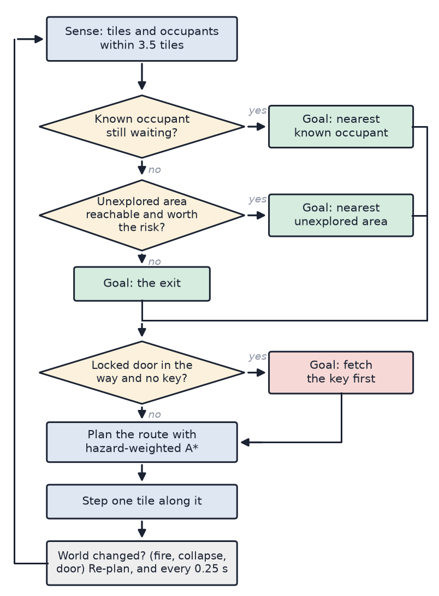
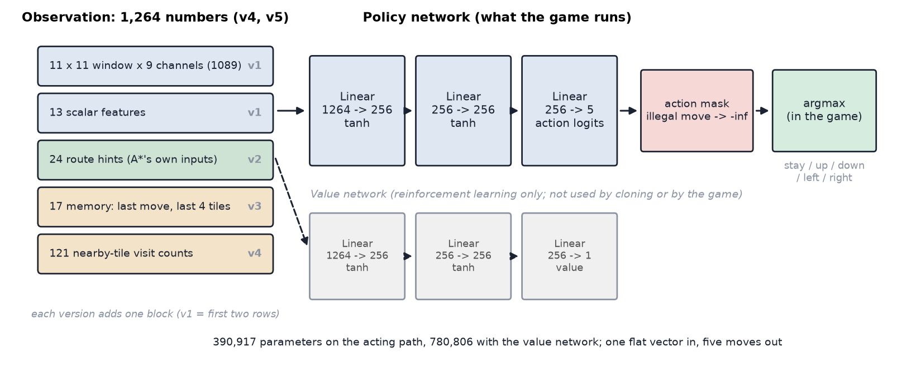
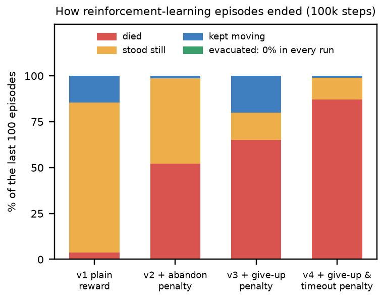
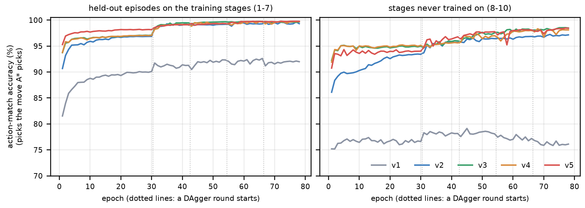
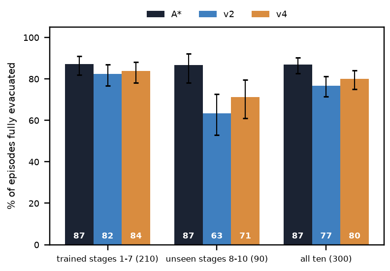
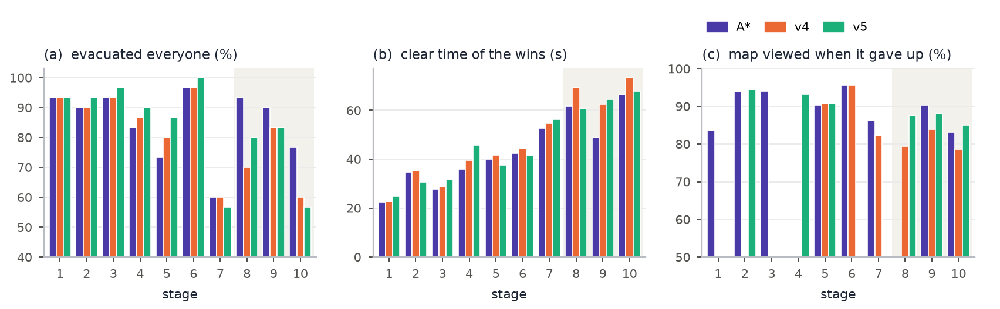

# CT3201 Mini Project — Project Report

**Project:** *Pyro Pete: Emergency Evacuation* — an evacuation‑routing AI agent
**Problem area:** search / intelligent agent / decision‑making under uncertainty

---

## Section 1 — Problem Definition  *(Phase 1, Stage 1 — done human‑first, before AI)*

**Problem.** When a building is on fire, occupants who don't know the layout
must be found and led to an exit before fire, smoke and structural collapse
cut the route off. A rescuer has to decide, moment to moment and with
incomplete information, **who to go to next and by what route** as conditions
change.

**User.** We first defined the users as building occupants, and secondarily safety officers or an automated guidance system. To make the problem visual we reframed it as a rescuer who searches for occupants and leads them out: a simulation in which students and players can watch, and race, an AI that makes these decisions.

**Environment.** A multi‑room floor plan modelled as a grid of connected
cells (the course's "floor plan as a graph"). Hazards evolve over time:
fire spreads from an ignition point, smoke thickens around it, electrical
panels arc, and the ceiling collapses in places. One internal door is
locked and needs a key found elsewhere. The rescuer can only see a small
radius around themselves — the rest of the building is unknown until
visited.

**Desired outcome.** All reachable occupants led out through the exit, then
the rescuer out too — as fast as possible and with as little exposure to
hazards as possible.

**Main decision.** *Given what I currently know, do I push deeper for
another occupant, or take the ones I have and get out now?* — a trade‑off
between more rescues (reward) and time / health / the risk of losing
everyone if the rescuer dies on the way back.

**"Think first" note.** Over two days we pooled candidate problems in a shared spreadsheet, each written in the brief's Stage 1 format (problem, user, environment, desired outcome, main decision). Ideas came from daily life and some entries' wording from Gemini and Claude. The choice was ours: we voted for Emergency Evacuation Routing, the course's own exercise, because it let us show the search algorithms from class working visually, as a game, inspired by videos of AI learning to play Mario and Pokémon.

---

## Section 2 — Initial Human Solution  *(Phase 1, Stage 2 — the AI formulation)*

We formulated the rescuer as a **goal‑based agent doing graph search over a
grid**, with hazards as costs rather than as walls where possible.

Table: The rescuer formulated as a search problem

| Element | Our project |
|---|---|
| **Agent** | one autonomous rescue unit (in‑game: the drone; the human plays the same role) |
| **State** | current cell · set of occupants and their status (waiting / following / out) · the part of the map seen so far · current health |
| **Actions** | move to one of the four adjacent floor cells |
| **Goal** | lead every reachable occupant to the exit, then reach the exit |
| **Transition** | deterministic movement; the *world* is non‑stationary — fire spreads, tiles collapse, the door unlocks |
| **Cost** | 1 per step, plus a hazard surcharge for the entered cell: fire +8, smoke +2 × density, sparking panel +7.5, a tile that is visibly about to collapse +25 |
| **Constraints** | walls and fallen debris are impassable; the locked door is impassable until the key is picked up; health drains while standing in a hazard and reaching 0 ends the run |
| **Information** | **partial** — only cells and occupants within a small vision radius are known; the agent plans on its current belief and re‑plans when reality differs |

**Initial plan (pre‑AI).** The rescuer searches the building; occupants who come within two squares see him and follow. Breadth‑first search finds the way. Fire was always meant to be a hazard that drains health rather than a wall, so pushing through it is a gamble between speed and survival, especially on later stages.

---

## Section 3 — AI‑Assisted Exploration  *(Phase 2, Stage 3)*

We used AI (Claude, via Claude Code) for **explanation, alternatives and
challenge** — not to design the project. Significant interactions are in
`docs/report/AI_INTERACTION_LOG.md`; the ones that changed the design:

Table: What we asked AI, what it surfaced and what we took from it {wide}

| We asked AI to… | What it surfaced | What we took from it |
|---|---|---|
| challenge our BFS plan | on a map where hazards are *passable but costly*, BFS minimises **tiles**, not **danger** — it will walk through fire to save a step | switched to treating hazards as **weighted costs** and using cost‑aware search |
| suggest alternative search strategies | Dijkstra, A\*, Greedy best‑first, and the trade‑offs (optimality vs node expansions vs heuristic reliance) | implemented all four so we could compare them on our own map |
| point out assumptions in the formulation | we assumed the agent had a full map of occupant locations — unrealistic for "you don't know the building" | added **partial observability**: the agent only knows an occupant once it has seen one, and explores otherwise |
| identify what could make the system fail | a locked door on the only corridor makes the goal unreachable; a random tile collapse could wall someone off | added the **key sub‑goal**, and a **connectivity check** that skips any collapse which would trap spawn / exit / an occupant |
| identify ethical risks | see Section 8 | evaluated each against our system rather than accepting the list |

---

## Section 4 — AI Critique and Student Decisions  *(Phase 3 & 4, Stages 4–5)*

We submitted the design to AI as a critical reviewer and recorded the
response, then decided **Accept / Modify / Reject** for each point with a
verification method.

Table: AI suggestions and critiques, our decision and how we verified it {wide}

| AI suggestion / critique | Decision | Why · verification method |
|---|---|---|
| Use **Greedy Best‑First** for the agent's pathfinding — fewer node expansions, so faster | **Reject** | Not cost‑optimal on a weighted map. **Verified** by running BFS / Dijkstra / A\* / Greedy from spawn to exit over the hazard cost function (`tools/search_comparison.py`): BFS costs ≈ 102 through **9** burning tiles vs A\*/Dijkstra ≈ 44 through **2**. Greedy happened to match A\* on that fire state (the straight‑line route was also the safe one) but it is heuristic‑only and diverges when it isn't. See `docs/search_comparison.md`. |
| Use **A\*** over the hazard cost function | **Accept** | Ties Dijkstra for least‑cost route, expands far fewer nodes. **Verified** against search theory (admissible Manhattan heuristic, min step cost 1) + the same harness. |
| Keep **BFS** for the unweighted jobs (fire‑spread ring counting, maze connectivity checks) | **Accept** | Those problems genuinely have no weights; BFS is the right tool. **Verified** by unit tests (`tests/test_core.py`). |
| Generate the NPC walk animations as **AI video**, then extract frames | **Reject** for the toward/away‑camera directions | The video model only produced stable **side‑view** clips with unstable proportions and no walk‑to‑camera. **Verified** against what the engine needs (4 directions, fixed sprite size, feet anchor). Corrected by assembling the sprites from mixed sources + procedural animation. See `docs/ai_critique.md` — this is the mandatory *identified → verified → corrected* example. |
| Make the maze a **perfect maze** (single path everywhere) | **Modify** | On a single‑path maze *every* search strategy returns the identical route, so the comparison is meaningless. **Verified** by observing BFS = A\* = Greedy path cost. Corrected by **braiding** the maze (`level_01.BRAID = 0.18`) so routing has real choices. |
| Give the AI agent a **full map of occupant locations** | **Reject** | Contradicts "you don't know the building" and makes the human‑vs‑AI race unfair. **Verified** by reasoning about the problem statement. Corrected with partial observability + frontier exploration. |

---

## Section 5 — Final AI Solution

A playable top‑down evacuation game (Python + Pygame). The player controls
Pete; an **autonomous rescue drone** runs the same map at the same time
under the same rules, and a results screen scores both.

### The Agent's Decision Loop

Fig. 1 shows the loop the agent runs.

### Techniques Used (from the Brief's List)

- **Search** — BFS, Dijkstra, A\*, Greedy best‑first, all over a per‑tile
  cost function (`pathfinding.py`).
- **Intelligent agent** — sense → decide → act loop with dynamic re‑planning
  (`entities/rescue_agent.py`).
- **Decision‑making under uncertainty** — partial observability; the agent
  commits to a belief, acts, and revises when it discovers the belief was
  wrong.

- **Machine learning (optional second brain)** — a neural network trained by reinforcement learning and
  by imitation of A\* (Section 7). It never replaces the A\* agent, which stays the default and the benchmark.

### Other Systems

Fire spread + functional smoke, sparking panels, timed ceiling collapse,
locked door + key, fog of war with memory, and a score
(+100 / occupant led out, +50 for exiting, speed bonus, damage penalty).

---

## Section 6 — Evaluation and Testing  *(Phase 6, Stage 7)*

**AI recommendation tested:** *"Use Greedy Best‑First Search — it expands
fewer nodes, so it's faster."*

**Test:** `tools/search_comparison.py` runs BFS / Dijkstra / A\* / Greedy
from spawn to exit over the same hazard cost function after the fire has
spread ~40 s. Representative result (seeded, reproducible):

Table: Search strategies from spawn to exit after about 40 s of fire (seeded)

| strategy | path cost | steps | hazard tiles crossed |
|---|---|---|---|
| BFS (unweighted) | 101.8 | 30 | 9 |
| Dijkstra | 43.8 | 42 | 2 |
| A\* | 43.8 | 42 | 2 |
| Greedy best‑first | 43.8 | 42 | 2 |

**Was AI's recommendation appropriate?** **No.** "Fewer node expansions" is
true, but it optimises the wrong thing. **BFS** minimises tile count, so on
a weighted map it takes the short route *straight through the fire* — here
~2.3× the cost of the safe route (102 vs 44) for the same step count.
**Greedy** is heuristic‑only: it matched A\* on the fire state above
because the roughly‑straight direction was also the safe one, but when the
fire is between the agent and the goal it barrels into it. Neither
minimises danger, which is what an evacuation agent needs.

**What evidence supports our conclusion?** The cost table above, and the same comparison repeated across every stage, three debris layouts and five fire‑spread times (150 situations, `tools/greedy_vs_astar_scan.py`): Greedy's route cost more than A\*'s in **98**, tied in 52, and was never cheaper. On stage 2 after 20 s of fire, A\* reaches the exit through no hazard tiles (cost 32) while Greedy crosses 16 (cost 195). Plus: A\* and Dijkstra always return the identical least‑cost route —
A\* just reaches it with fewer expansions because its heuristic aims it at
the goal. So we get optimality *and* most of the speed. **Decision: A\* for
the agent; Greedy and BFS rejected for routing; BFS kept only for the
unweighted jobs.**

**Unit tests** (`tests/test_core.py`, 12 tests): maze always fully
connected; BFS returns the shortest path / `None` when unreachable; A\*
matches BFS cost with no hazards and detours around a costed tile; Greedy
can be worse than A\* on cost; fire never ignites on spawn; panels avoid
reserved cells; the key is always reachable with the door shut; debris
never isolates a protected cell.

---

## Section 7 — Learning the Rescuer: From Reinforcement Learning to the v5 Imitation Model

The earlier sections describe a hand-designed agent: hazard-weighted A\* [1] over the whole floor plan. This section reports an additional, optional brain for the same body: a small neural network that chooses each step. It does not replace A\*, which stays the default and the benchmark. It is written as a development history, because the road to the final model (v5) contained more corrections than successes, and the corrections are the part we learned from. Every number comes from seeded, paired episodes of the real game; the logs, the predictions we wrote down before some runs, the data tables and the screen recordings are in `pyro_pete_game/ml/ML_Findings/`.

In one line: reinforcement learning from the game score failed completely (0% of episodes fully evacuated), imitating A\* worked, and the version that finally matched A\* overall (v5: 84% against 85% on 300 fresh episodes) needed a string of corrections to our own assumptions (listed at the end of this section). It still trails A\* on stages it has never seen (73% against 87%).

### Motivation and Starting Assumptions

The research question was: *can a neural network, trained on the game itself, learn to lead occupants out of a burning building?* A learned policy takes constant time per decision, adapts to whatever it was trained on, and might find strategies a designer did not think of. We wanted to measure how far a plain network gets against a strong hand-written baseline, not to win.

The task is a partially observable Markov decision process [2]. The agent sees only within 3.5 tiles (fog of war). It chooses one of five moves (stay, up, down, left, right), executed by the game's own movement. An episode is one stage played by the AI alone. *Accuracy* in this section means the share of episodes that end with everyone still alive led out (called *evacuated*); the other endings are *died* and *gave up* (stood still for 12 s, the game's own rule, which also ends A\*'s run when it stops).

We began with four assumptions. Writing them down first is what let us find, later, which were wrong.

1. **The game score is a sufficient reward** [3]: +100 per occupant led out, +50 for reaching the exit, up to +60 for speed, −0.4 per health point lost, plus −100 for dying, −0.05 per second and −0.2 per wall bump added for training. We deliberately added no distance-to-goal shaping, because paying an agent for "getting closer" invites exploitation [4], [5].
2. **A local view is a fair view.** An 11 × 11 window of tiles around the agent (9 channels per tile) plus 13 scalars was believed to be "the same fog of war A\* has", so any comparison would be fair.
3. **A small fully connected network is enough**, because the state is a vector, not an image.
4. **If it fails, more training or a better reward will fix it.**

Assumptions 1, 2 and 4 turned out to be false; assumption 3 held.

### Model Architecture

#### Design and why it was selected

The learner is a *MaskablePPO* actor-critic from sb3-contrib on Stable-Baselines3 [6], built on PyTorch [7] and a Gym-style environment [8] that steps the real `GameSession` (nothing is re-implemented). The policy is a multilayer perceptron with two hidden layers of 256 tanh units and a five-way output; a separate, identical network estimates the value and is used only in reinforcement learning (Fig. 2). Table V summarises the specification.

{wide}

Table: Architecture and training specification (identical for every version except the observation size)

| Item | Setting |
|---|---|
| Input | one flat vector: 1,102 numbers (v1), 1,126 (v2), 1,143 (v3), 1,264 (v4, v5) |
| Policy network | 2 hidden layers of 256 tanh units, then 5 action logits; 390,917 parameters (780,806 with the value network) |
| Output | illegal moves masked to probability zero; the game plays the most likely move |
| Reinforcement learning | MaskablePPO, 6 parallel environments, 3,072 steps per epoch, learning rate 3e-4, discount 0.995, GAE 0.95, entropy 0.01, clip 0.2, reward-only normalisation |
| Cloning (supervised) | cross-entropy on the masked logits, Adam (1e-3, cosine schedule), batch 512, 30 epochs; then 4 DAgger rounds of 12 epochs |
| Hardware | CPU only: about 87% of training time is spent simulating the game, so a GPU gave no benefit |

We chose this design for five reasons.

- **The input is a vector, not a picture.** Tile channels, health and distances are already numbers, so a plain network is enough, and cheap enough to decide a few times a second on a CPU.
- **Legal moves depend on the state.** Masking removes illegal actions exactly, gives a valid policy gradient, and scales better than punishing invalid actions with negative reward [9].
- **PPO is stable and forgiving** [10]. Its clipped updates need little tuning.
- **One network, two trainers.** The same network is trained by reinforcement learning and by supervised cloning, so the two results are directly comparable, and one small file loads into the game (`ml/models/`).
- **Small on purpose.** Under 400,000 parameters keeps decisions fast and the experiments repeatable in minutes.

#### Where these techniques have been used

Each ingredient has a strong record elsewhere. PPO trained agents for the game Dota 2 at large scale [11], controlled a robot hand solving a Rubik's Cube [12] and fine-tuned language models from human feedback [13]. Learning a policy from expert examples goes back to ALVINN steering a vehicle from human driving [14] (surveyed in [15]). DAgger repairs the compounding errors of plain cloning by letting the learner drive while the expert relabels the states it reaches [16]. Expert data followed by reinforcement learning is how AlphaGo's policy network was first trained [17], and demonstrations combined with value-based reinforcement learning sped up learning on Atari games [18].

#### Alternative architectures

We did not run these, and each is a serious candidate. Table VI says what each would change here. The strongest matches to our observed failures are the first three.

Table: Alternative architectures and how they would fit this problem {wide}

| Architecture | What it would change | Fit to this problem |
|---|---|---|
| Convolutional network on the 11 × 11 window | Uses the spatial layout instead of flattening it, as in [19] | Strong: the window is an image, and our network must learn geometry from scratch, which is a likely cause of the weaker results on unseen mazes |
| Recurrent policy (LSTM or GRU) | Learns its own memory of the past [20] instead of our hand-built trail features | Strong: memory was needed to reduce pacing (below) and we had to build it by hand |
| Graph neural network over the floor-plan graph | Treats the building as nodes and passages [21], independent of map size and orientation | Strong for unseen maps; the same graph framing our search already uses |
| Transformer over the episode history | Conditions on a long history, e.g. the Decision Transformer [22] | Could hold a full-episode memory; needs more demonstration data than we generated |
| Value iteration network or Neural A\* | Learns planning, or A\*'s guidance costs, inside the network [23], [24] | Keeps A\*'s structure and learns only what is hard to hand-write, such as hazard cost |
| Value-based deep RL (DQN, Rainbow) | Off-policy learning with replay [19], [25] | The sparse-reward obstacle remains; it needs demonstrations to start, as in [18] |
| Tree search guided by a learned policy | AlphaGo-style planning [17] | Needs a fast copy of the game; our simulator is the game itself, which is slow |

### Development History: v0 to v5

Table VII summarises the six models; the subsections below tell the story of each.

Table: The models in order, with the assumption behind each, the result and what it revealed {wide}

| Model | What changed | Assumption behind it | Result (all ten stages) | What it revealed |
|---|---|---|---|---|
| v0 | Reinforcement learning from the game score, local view | The score is enough reward | 0% evacuated in every run | The optimiser only compares ways of failing and learns to stand still |
| v1 | Behaviour cloning of A\* with DAgger, local view | A local window is what A\* sees | 20% (13–29) | A\* sees far more than we had claimed |
| v2 | + 24 route hints built from A\*'s own inputs | Give the learner A\*'s information | 80% (71–87) | Loops between two tiles: no memory |
| v3 | + memory of the last move and last 4 tiles | Memory removes the loops | 84% (76–90) | Gains shrink on fresh episodes |
| v4 | + visit counts of nearby tiles | Full-episode memory is fair (A\* remembers too) | 87% (79–92); 80% pooled | Remaining failures are stalls and copied caution |
| v5 | Teacher searches the far side first; skips tiny corners | A better teacher raises the ceiling | 84% on 300 fresh episodes, A\* 85% | Level with A\* overall, still behind on unseen stages |

#### Reinforcement learning from the game score (v0)

**Setup.** MaskablePPO on stages 1–3, validated on stage 4, 100,000 steps per run and three seeds per setting, twelve runs in all. The baselines on ten stages were: A\* 86% (81–91), random legal moves 0% and standing still 0%. The expected return of a full A\* run is about +397.

**What happened.** Under the plain score reward the network learned to stand still: 74–91% of episodes ended by giving up, and none evacuated. The cause is arithmetic, not a bug. Random exploration never led anyone out, so the optimiser never saw a positive outcome and could only compare ways of failing. Standing still costs about −0.6, dying about −142. The cheapest failure wins [5]. We had flagged sparse reward as the main risk before training; it is exactly what happened.

**Revisions and responses.** Each change made the failure more expensive, and each time the collapse moved instead of disappearing (Fig. 3):

- *v2, abandon penalty (100 per occupant left inside):* about half the episodes died and half stood still; still no rescue.
- *v3, give-up penalty (200):* giving up fell to 0% in one seed but stayed at 30% in another; the collapse did not move to timeouts as we had predicted.
- *v4, give-up and timeout penalties:* 87% died; the mean return of −151 was worse than the random starting policy (−142).
- *Longer runs:* 300,000 steps with the abandon penalty gave 0 rescues in 98 epochs; the best run (give-up penalty, 300,000 steps) reached 23% of occupants led out but only 1–5% full evacuations.

**Concept revised.** Adjusting failure penalties changes which failure the network prefers; it cannot create a success signal that random exploration never finds. We needed a way to put the network in contact with success, and A\* already provides one.

#### Behaviour cloning with DAgger (v1)

**Concept.** Let A\* play, record what the agent saw and the move A\* chose, and train the network to reproduce that move. The metric is *action-match accuracy*, a real accuracy in the usual sense, logged every epoch. It removes the incentive problem entirely: there is no reward to prefer standing still to, and A\* stands still in only 1.1% of its decisions. Plain cloning suffers when the learner drifts into states the expert never visited, so we added DAgger [16]: in four rounds the network drives with probability 1 − β (β = 0.5, 0.3, 0.1, 0) while A\* labels every state, and the new examples are added to the training set. We trained on stages 1–7 and kept stages 8–10 completely unseen.

**v1 result.** With the local-window observation the network matched A\*'s move on 92% of held-out steps on trained stages but only 76% on unseen stages, and played the game far worse: **20% evacuated (13–29) against 91% for A\*** on the same 100 episodes.

**Problem found.** Reading A\*'s planner to understand this showed our assumption 2 was false. A\* does not see only a local window: it plans over the *whole real map* using the *live hazard field everywhere*; only the occupants' positions are hidden (visible within 3.5 tiles). The learner had strictly less information than its teacher, so the teacher's move was often not a function of anything the student could see. We had written the opposite in our first documentation, and corrected it everywhere once found.

**Concept revised: information parity.** The learner and A\* must get the same conditions. If the learner sees less, the labels are unlearnable; if it sees more, the comparison is meaningless (a "God mode"). We now enforce this with tests rather than statements: moving an occupant the agent has not spotted changes no number in the observation nor A\*'s decision; once spotted, it does; both agents share the same body and the same seeded game.

#### Giving the network A\*'s information (v2)

**Change.** Twenty-four *route hints* were added, computed from A\*'s own inputs: for each of A\*'s four candidate goals (the exit, the nearest spotted occupant, the nearest unexplored area, the key) the hazard-weighted path cost from the agent and how much each of the four moves shortens it. The network still has to decide *which goal to pursue and when*. Our first version omitted the key: every stage starts behind a locked door, so the exit is unreachable at spawn and the exit hint was empty. Our own test failed and exposed it.

**Result.** 80% evacuated (71–87), from 20%; action-match 99.3% on trained and 97.2% on unseen stages.

**Correction to the test itself.** We had capped episodes at 90 s for speed. The real game has no hard time limit, and a cap penalises whichever agent is slower, so every test was rerun with a 240 s cap.

**Problem found by watching recordings.** After watching the clips, the project owner noticed that winning runs look like A\*, while failing runs go along normally and then *walk back and forth between two tiles* until they die or give up. Measured, 39 of 200 fresh v2 episodes contained a long back-and-forth run; A\* had none.

**Concept revised.** The network has no memory: the same observation gives the same move, so a loop is a fixed point. We needed to give it a memory of where it had been.

#### Adding memory (v3, v4)

**Assumption and fairness.** A\* itself remembers what it has explored and every occupant it has spotted, so a memory that starts empty in each episode and fills only as the agent walks is within the same-conditions rule (also tested). v3 adds 17 numbers: the last move and the offsets of the last four tiles. v4 adds 121 numbers: how often the agent has stood on each nearby tile.

**Results.** On the first 100 episodes: v3 84% (76–90) and v4 87% (79–92); episodes with long back-and-forth runs fell from 19 (v2) to 10 (v3) to 5 (v4) per 100.

**Problem found: our own headline.** We wrote a prediction for the confirmation before running 200 episodes nobody had used: v4 would stay inside the interval it already had. It did not: v4 scored 76% (70–82), v2 75%, while A\* moved from 91% to 85%. Test sets swing by about 6 points, and part of our first "memory gain" of 7 points was the first test set being reused. Two of our three predictions about memory were falsified. What replicated was the drop in pacing (39 to 15 episodes of 200) and in deaths. Pooling both sets (300 episodes) memory adds 3 points (77% to 80%; v4 won 15 episodes that v2 lost and lost 5; sign test p ≈ 0.04).

**Concept revised.** Confirm on fresh seeds before writing a headline; pool independent test sets; never write "every failure does X" from ten cases (we had written that every give-up contained pacing; on fresh episodes it was 60%).

#### What was still failing in v4

We analysed the pooled sets 1 and 2 (300 episodes per agent) for what remained.

- **Stalling.** A stall is at most three different tiles among the last 16 entered. A\* never stalls (0 of 300); v2 stalls in 17% of episodes and v4 in 8%. Stalling is concentrated on the unseen stages (v4: 23% against 1% on trained stages), and while stalled the network's consecutive moves change goal 77% of the time (7% otherwise): it is undecided between goals rather than lost. As an upper bound, letting A\* break each stall lifts v2 from 77% to 84% but v4 only from 80% to 83%: stalling is a large problem for the memoryless network and a modest one for v4.
- **Give-ups are often copied caution.** A\* gives up when a search is "not worth the risk": if the round trip to the nearest unexplored area would cost more than 60% of its health, it walks to the exit and stops. It did so in 16 of the 300 episodes. In 23–24 of v4's 36 give-ups, A\* would also have stopped in the same state, so the network is reproducing A\*'s caution, which it cannot compute (it has no route-damage input); the other 13 are real errors.
- **A stricter metric than the game's.** A give-up keeps most of the score (an average of about 488 against 536 for a full evacuation), while dying scores about 37. Averaged over all 300 episodes, A\* scores about 505 and v4 about 490, a 3% gap against the 7-point gap in the evacuation rate.

#### Improving the teacher (v5)

**Idea.** The network can only match the teacher, so raising the ceiling means improving the teacher. A\* searches the *nearest* unexplored area first. We replaced only that choice, inside the test workers so the benchmark stayed untouched, and tried five search orders on 300 episodes each. Leaning towards the far side of the map (relative to the exit) while still preferring nearby areas raised evacuation from 87% to 91%; on 200 fresh episodes we had predicted a gain and got it (90% against 84%). Forcing the far side only (79%) or sweeping outward from the exit (81%) was worse.

**Problem found.** A test showed that our first far-side rule measured distance from the exit while the locked door was still closed, so everything behind the door had no distance and the rule silently did nothing there. We fixed it to use the static floor plan and re-measured everything; the conclusion held.

**The corner rule.** The project owner asked that, near a corner where no occupant has been found, the agent should not make a special trip into it just to finish looking at every tile, while keeping the fog of war unchanged. We implemented it as *skip a search target that would reveal fewer than K unseen floor tiles*. Table VIII shows the trade.

Table: Teacher variants on 300 episodes: far-side search and the corner rule

| Teacher | Evac. | Gave up | Score | Time |
|---|---|---|---|---|
| A\* (benchmark, nearest first) | 87% | 5% | 505 | 41 s |
| Far side first | 91% | 2% | 509 | 43 s |
| **Far side + skip corners under 4 tiles (v5's teacher)** | **91%** | 3% | **512** | 42 s |
| Far side + skip corners under 8 tiles | 81% | 13% | 507 | 40 s |
| Far side + skip corners under 12 tiles | 60% | 38% | 487 | 33 s |

Skipping only tiny corner remnants costs nothing; skipping larger ones is faster but loses occupants, because an occupant is sometimes in the corner and, once one is missing, the corner is the only place left. We shipped the mild setting. **v5** is v4's network, observation and training recipe, trained on this teacher (22 minutes on a CPU). The observation's "unexplored area" hint is computed by the same rule, so learner and teacher still share one view.

### Evaluation

#### Method

Every comparison uses the *same seeded episodes* for all agents (same map, occupants and hazards), a 240 s cap, and the deterministic policy, which is what the game uses. Proportions carry Wilson 95% intervals [26]; paired comparisons use an exact sign test on the episodes that only one agent won. We used three independent test sets: set 1 (100 episodes), set 2 (200 fresh episodes) and set 3 (300 fresh episodes, used only for the final A\*, v4 and v5 comparison and never for training, model choice or teacher choice). Stages 1–7 were trained on and 8–10 never.

#### Accuracy of every version against A\*

Table: Accuracy (episodes fully evacuated, 95% interval) of each version against A\* {wide}

| Model | Action match: trained / unseen stages | Set 1 (100) | Set 2 (200) | Sets 1+2 (300) | Set 3 (300) |
|---|---|---|---|---|---|
| v0 (reinforcement learning) | not applicable | 0 of 40 (stages 1–4) | not run | not run | not run |
| v1 (local window) | 92.0% / 76.1% | 20% (13–29) | not run | not run | not run |
| v2 (+ route hints) | 99.3% / 97.2% | 80% (71–87) | 75% (69–80) | 77% (72–81) | not run |
| v3 (+ short memory) | 99.7% / 98.5% | 84% (76–90) | not run | not run | not run |
| v4 (+ full trail) | 99.7% / 98.1% | 87% (79–92) | 76% (70–82) | 80% (75–84) | 81% (77–85) |
| v5 (far-side teacher) | 99.8% / 98.4% | not run | not run | not run | 84% (79–87) |
| **A\* (benchmark)** | not applicable | 91% (84–95) | 85% (79–89) | 87% (83–90) | 85% (81–89) |

The A\* row shows how much a test set moves the numbers (85% to 91%), which is why versions are compared within a set, never across sets. Action-match accuracy is at least 97% for v2 to v5, yet v2 evacuates 10 points less often than A\* (pooled): matching one step is not the same as finishing the stage, because a single wrong step can start a loop. v1's weak matching (92% on trained and 76% on unseen stages) was matched by its weak play.

{wide}

#### Final comparison on fresh episodes (set 3)

On set 3, the final comparison, the three agents split as follows (Table X): on the trained stages v5 is at 88% against A\*'s 84%, and on the three unseen stages it is at 73% against 87%.

Table: Set 3 (300 fresh episodes): evacuated, 95% interval, and mean score per episode

| Agent | Trained 1–7 (210) | Unseen 8–10 (90) | All (300) | Score |
|---|---|---|---|---|
| A\* | 84% (79–89) | 87% (78–92) | 85% (81–89) | 494 |
| v4 | 86% (80–90) | 71% (61–79) | 81% (77–85) | 472 |
| v5 | 88% (83–92) | 73% (63–81) | 84% (79–87) | 477 |

Paired on the same 300 episodes, A\* won 22 that v5 lost and v5 won 18 that A\* lost (p = 0.64): the two cannot be told apart. A\* against v4 was 19 to 8 (p = 0.052), and v5 against v4 was 24 to 17 (p = 0.35): v5's gain over v4 is not established.

Table: Stage by stage on set 3: share evacuated, clear time of the wins and score of the wins {wide}

| Stage | A\* evac. | v4 evac. | v5 evac. | A\* time (s) | v4 time (s) | v5 time (s) | A\* score | v4 score | v5 score |
|---|---|---|---|---|---|---|---|---|---|
| 1 | 93% | 93% | 93% | 22 | 23 | 25 | 395 | 395 | 393 |
| 2 | 90% | 90% | 93% | 35 | 35 | 31 | 382 | 381 | 385 |
| 3 | 93% | 93% | 97% | 28 | 29 | 32 | 480 | 479 | 478 |
| 4 | 83% | 87% | 90% | 36 | 40 | 46 | 478 | 474 | 467 |
| 5 | 73% | 80% | 87% | 40 | 42 | 38 | 577 | 574 | 580 |
| 6 | 97% | 97% | 100% | 42 | 44 | 41 | 574 | 573 | 574 |
| 7 | 60% | 60% | 57% | 53 | 54 | 56 | 665 | 666 | 666 |
| 8 (unseen) | 93% | 70% | 80% | 62 | 69 | 60 | 651 | 648 | 650 |
| 9 (unseen) | 90% | 83% | 83% | 49 | 62 | 64 | 670 | 660 | 658 |
| 10 (unseen) | 77% | 60% | 57% | 66 | 73 | 68 | 650 | 649 | 651 |
| All | 85% | 81% | 84% | 43 | 45 | 44 | 546 | 538 | 538 |

{wide}

Table: When the agents gave up (set 3, all stages): occupants found and saved, and share of floor tiles viewed

| Agent | Give-ups | Found | Saved | Map viewed |
|---|---|---|---|---|
| A\* | 15 | 72% (3.9 of 5.3) | 3.9 | 88% |
| v4 | 18 | 81% (4.7 of 5.8) | 4.5 | 83% |
| v5 | 14 | 79% (4.4 of 5.6) | 4.4 | 88% |

Wins are equally fast and equally scored for all three (43 to 45 s; 538 to 546 points). Stage 7 is the shared weak spot: A\* wins 60% there, and v5 died 13 times in 30 against A\*'s 7. When A\* gives up it has saved everyone it found; the networks sometimes find occupants they then fail to bring out.

### Discussion

#### Concepts given and revised

1. **Reward is not enough on its own.** With no early success to learn from, penalties only relocate the failure; demonstrations supply the missing success signal.
2. **Same information, enforced by tests.** Our first claim of parity was false and was corrected; parity is now a set of failing-if-broken checks.
3. **A time cap favours the faster agent.** The 90 s cap was replaced by 240 s.
4. **Missing memory causes loops,** but the measured gain from adding it is modest (3 points pooled), and our first estimate was inflated by reusing a test set.
5. **Give-ups are not all errors.** Roughly two thirds copy A\*'s own risk rule, and the success metric is stricter than the game's score.
6. **The teacher is a lever.** Improving the search order the network imitates helped as much as any change to the network; and we found and fixed a flaw in our own rule (the closed door) only because a test failed.

#### Limits and threats to validity

- Each version was trained once (one random seed), so a difference of a few points between versions may be seed noise; the sign tests do not remove that.
- Test sets were reused across versions; the fresh sets 2 and 3 were added to limit this, and one of our registered predictions failed because of it.
- Only three stages are unseen, so the generalisation figure (73% against 87%) rests on 90 episodes per agent.
- Route hints are computed with A\*'s own path costs, so v2 to v5 learn to *use* A\*'s outputs rather than learning to plan from scratch. This is the price of parity with the teacher and the reason we do not present these models as independent planners. The hints are computed from each goal back to the agent. This picks the same best move as A\*, but when the agent stands on a hazard the hint values shift by that tile's cost, so they are A\*'s ranking of moves rather than its exact costs (found by an automated code review; correcting it would mean retraining v2 to v5).
- The network copies A\*'s biases, including nearest-first choice of occupants (Section 8).

#### Where this could go next

The clearest untested idea is a route-damage input, so the network can reproduce A\*'s risk rule instead of guessing it. Beyond that, generating more training stages with the maze generator to close the unseen-stage gap; the recurrent, convolutional and graph architectures of Table VI; and reinforcement-learning fine-tuning starting from the clone and anchored to A\*, the demonstrations-then-RL route that [17] and [18] took.

---

## Section 8 — Responsible AI  *(Phase 7, Stage 8)*

We asked: **should this AI system actually be deployed?** and evaluated it
on each dimension.

**Fairness.** In‑game the comparison is fair *by construction* — the drone has health and takes hazard damage exactly like the human, and both see only a small radius. A real deployment fairness question: does the "nearest occupant" rule systematically reach some people last (e.g. those furthest from the rescuer's entry point)?

**Bias.** The agent's goal selection is **greedy nearest‑first**. It has no notion of who is most at risk — a mobile adult far from fire is chosen over a less‑mobile person close to it if the adult is nearer. A deployed version would need a triage signal, and that signal could itself be biased.

**Transparency.** The agent **draws its planned route and its walked trail**, so a person watching can see *what* it decided and *why it changed its mind*. This is a deliberate design choice — an opaque "trust me" router would be much harder to accept.

**Privacy.** A real occupant‑locating system needs live location data on people inside a building. That is sensitive personal data; it must be minimised, access‑controlled, and deleted after the incident.

**Security.** The agent trusts its hazard map. If that map (sensor feed) were spoofed, an attacker could steer the agent — and any people following it — *into* a hazard. Integrity of the inputs matters as much as the algorithm.

**Accountability.** If the agent leads someone into a collapse, who is responsible — the operator, the developer, the sensor vendor? A deployed system needs a clear answer and an audit log (the route history the game already records is a start).

**Human oversight.** Our system is a **comparison / decision‑support** tool, not an autonomous replacement for firefighters. That is the right posture: the AI proposes a route, a human decides.

**Additional risks we asked AI to identify, and our verdict:**

Table: Further risks suggested by AI, and our verdict

| AI‑suggested risk | Relevant to our system? |
|---|---|
| Over‑reliance: rescuers stop building their own mental map | **Yes** — real. A deployed tool should show *why*, not just *where*. |
| The agent optimises for its own survival over the people it's leading | **Yes** — worth stating as an explicit design constraint. |
| Automation could justify cutting trained‑rescuer headcount | **Yes** — a policy risk, not a technical one, but real. |
| Model hallucination produces an impossible route | **Low** for us — the route comes from A\* on a real graph, not a language model. |
| Adversarial inputs to a neural component | **Applies only to the optional learned brain (Section 7), not to the A\* agent.** A network can misjudge inputs A\* handles routinely (it trails A\* on stages it has never seen: 73% against 87%), so it is never the default and A\* stays the benchmark. |

**Should it be deployed?** As a real rescue system, no: it was never meant to replace people, and the concerns above (triage bias, trust in the hazard sensors, accountability) would all need answering first. As what it is, an interactive showcase that makes the search algorithms we learnt in class visible, yes: anyone who plays can see that the rescuer racing them runs on A\*, and read the lecture notes to learn more. There is little risk here: no real building and no personal data.

---

## Section 9 — Human‑AI Reflection  *(Phase 8, Stage 9 — MANDATORY, rewrite in your own words)*

> These are **first‑draft answers** from what actually happened during the
> project. Rewrite each in your own words and add what a draft can't know
> (your other AI chats, disagreements within the team, dead ends).

1. **What did AI help us understand or accomplish?** It explained the
   difference between minimising *tiles* and minimising *cost*, which
   redirected us from plain BFS to weighted search. It
   listed search alternatives and their trade‑offs quickly. It challenged
   assumptions we hadn't noticed (full occupant map; single‑path maze
   making the comparison meaningless). It accelerated the implementation
   and the sprite pipeline.

2. **What did AI get wrong?** The generative *video* model could not
   produce a usable walk‑toward‑camera animation for the occupant NPCs —
   only unstable side‑view clips. It also recommended Greedy Best‑First as
   "faster" without weighting that "faster to compute" ≠ "safer route",
   which is what our problem needs.

3. **Which AI suggestions did you accept?** Weighted hazard costs in the
   search; A\* over the cost function; keeping BFS for unweighted jobs;
   partial observability; the key sub‑goal; the connectivity‑checked
   collapse; braiding the maze.

4. **What did you change / modify after checking?** Maze: perfect →
   braided. Sprite pipeline: AI‑video extraction → mixed‑source assembly +
   procedural animation. Routing: fire, smoke and panels became costs in the search, so the
   agent weighs a dash through danger against a longer safe route.

5. **Which AI suggestions did you reject?** Greedy Best‑First for routing;
   BFS for routing; the full occupant map; the AI‑video approach for the
   toward/away directions.

6. **Why did you reject them?** Greedy/BFS aren't cost‑optimal on a
   weighted map — evidence in Section 6. The full map contradicts the
   problem statement and unbalances the human‑vs‑AI race. The video
   approach failed the engine's requirements (4 stable directions).

7. **How did you verify AI‑generated information?** Course knowledge
   (search theory), a purpose‑built comparison harness with a cost table,
   12 unit tests, and checking generated assets against concrete engine
   requirements rather than "it looks right".

8. **How did AI influence the final design?** The core routing approach
   (weighted A\*), the decision to implement four search algorithms for
   comparison, partial observability, and several robustness features
   (key, safe collapse) came out of AI‑prompted challenge — but the
   weights, the scoring, the balance and every accept/reject call were
   ours.

9. **Where was human judgement necessary?** Recognising that the AI‑video
   failure was *narrow* (one model, one axis) and could be routed around
   rather than abandoning AI art entirely. Deciding the scope reduction
   (occupant NPCs don't need 4 walk directions). Choosing to keep BFS
   where it's genuinely correct. All the tuning. The Responsible‑AI
   position.

10. **What if you had blindly followed AI?** With Greedy Best‑First, the
    agent would lead people *through the fire* whenever the exit was
    roughly beyond it — taking heavy damage, sometimes dying mid‑escort
    and losing everyone — while reporting a "shorter" path. It would look
    like bad game balance, not a wrong algorithm choice, and we'd have
    debugged the wrong thing.

11. **What did you learn about using AI responsibly?** AI is fast at
    *breadth* (options, critiques, explanations) but you have to supply
    the *objective* it's optimising against and then verify against it.
    A suggestion that is technically true ("fewer expansions") can still
    be wrong for your problem. Checking output against a concrete spec you
    wrote yourself is what catches this.

---

## Section 10 — Conclusion

We designed an evacuation‑routing agent human‑first, then used AI to
challenge and broaden the design. AI moved us from an unweighted BFS plan
to a hazard‑weighted A\* agent that plans under partial information and
re‑plans as the building changes, and it prompted several robustness
features. Testing an AI recommendation (Greedy Best‑First) against a
purpose‑built comparison showed it was inappropriate for our objective,
and we rejected it with evidence. The AI's clearest failure — generating
directional NPC animation — was recognised, verified against the engine's
requirements, and routed around. Throughout, AI accelerated the work and
widened the option space, but the objective, the verification, and every
final decision were ours.

We then asked whether a neural network could learn the same job. Reinforcement learning from the game score alone could not (0% of episodes evacuated; the network learned to stand still), so we switched to imitating A\* and recorded every assumption that turned out to be wrong: the information the learner was given, the test time cap, the size of the memory gain, and a flaw in our own search-order rule. The final model (v5) evacuates 84% of 300 fresh episodes against A\*'s 85%, a difference we cannot distinguish from noise, but it remains behind A\* on stages it has never seen (73% against 87%). A\* stays the default and the benchmark.

---

## Appendix — where each thing lives in the repo

Table: Where each part of the project lives in the repository

| Topic | File |
|---|---|
| The agent | `pyro_pete_game/entities/rescue_agent.py` |
| Search algorithms | `pyro_pete_game/pathfinding.py` |
| Hazard cost model | `pyro_pete_game/hazard_field.py` + `hazards.py` `panels.py` `debris.py` `doors.py` |
| Scoring / stats | `pyro_pete_game/stats.py`, results screen `results.py` |
| Search‑strategy test | `tools/search_comparison.py`, write‑up `docs/search_comparison.md` |
| "What AI got wrong" (assets) | `docs/ai_critique.md` |
| Unit tests | `pyro_pete_game/tests/test_core.py` |
| Playtest feedback | `playtesting/` |
| Learned agent: environment, network, cloning, DAgger | `pyro_pete_game/ml/`, `tools/train_imitation.py` |
| Trained models v4 and v5 (offered in Watch AI Play) | `pyro_pete_game/ml/models/` |
| Findings: logs, predictions, data, figures, recordings | `pyro_pete_game/ml/ML_Findings/` |

---

## References

[1] P. E. Hart, N. J. Nilsson, and B. Raphael, "A formal basis for the heuristic determination of minimum cost paths," *IEEE Trans. Syst. Sci. Cybern.*, vol. 4, no. 2, pp. 100–107, 1968.

[2] L. P. Kaelbling, M. L. Littman, and A. R. Cassandra, "Planning and acting in partially observable stochastic domains," *Artif. Intell.*, vol. 101, no. 1–2, pp. 99–134, 1998.

[3] R. S. Sutton and A. G. Barto, *Reinforcement Learning: An Introduction*, 2nd ed. Cambridge, MA, USA: MIT Press, 2018.

[4] A. Y. Ng, D. Harada, and S. Russell, "Policy invariance under reward transformations: Theory and application to reward shaping," in *Proc. 16th Int. Conf. Mach. Learn. (ICML)*, 1999, pp. 278–287.

[5] D. Amodei, C. Olah, J. Steinhardt, P. Christiano, J. Schulman, and D. Mané, "Concrete problems in AI safety," arXiv:1606.06565, 2016.

[6] A. Raffin, A. Hill, A. Gleave, A. Kanervisto, M. Ernestus, and N. Dormann, "Stable-Baselines3: Reliable reinforcement learning implementations," *J. Mach. Learn. Res.*, vol. 22, no. 268, pp. 1–8, 2021.

[7] A. Paszke et al., "PyTorch: An imperative style, high-performance deep learning library," in *Adv. Neural Inf. Process. Syst. (NeurIPS)*, vol. 32, 2019.

[8] G. Brockman et al., "OpenAI Gym," arXiv:1606.01540, 2016.

[9] S. Huang and S. Ontañón, "A closer look at invalid action masking in policy gradient algorithms," in *Proc. Int. FLAIRS Conf.*, vol. 35, 2022, doi: 10.32473/flairs.v35i.130584.

[10] J. Schulman, F. Wolski, P. Dhariwal, A. Radford, and O. Klimov, "Proximal policy optimization algorithms," arXiv:1707.06347, 2017.

[11] C. Berner et al., "Dota 2 with large scale deep reinforcement learning," arXiv:1912.06680, 2019.

[12] I. Akkaya et al., "Solving Rubik's Cube with a robot hand," arXiv:1910.07113, 2019.

[13] L. Ouyang et al., "Training language models to follow instructions with human feedback," in *Adv. Neural Inf. Process. Syst. (NeurIPS)*, vol. 35, 2022.

[14] D. A. Pomerleau, "ALVINN: An autonomous land vehicle in a neural network," in *Adv. Neural Inf. Process. Syst. (NIPS)*, vol. 1, 1989, pp. 305–313.

[15] T. Osa, J. Pajarinen, G. Neumann, J. A. Bagnell, P. Abbeel, and J. Peters, "An algorithmic perspective on imitation learning," *Found. Trends Robot.*, vol. 7, no. 1–2, pp. 1–179, 2018.

[16] S. Ross, G. Gordon, and D. Bagnell, "A reduction of imitation learning and structured prediction to no-regret online learning," in *Proc. 14th Int. Conf. Artif. Intell. Statist. (AISTATS)*, 2011, pp. 627–635.

[17] D. Silver et al., "Mastering the game of Go with deep neural networks and tree search," *Nature*, vol. 529, no. 7587, pp. 484–489, 2016.

[18] T. Hester et al., "Deep Q-learning from demonstrations," in *Proc. AAAI Conf. Artif. Intell.*, 2018.

[19] V. Mnih et al., "Human-level control through deep reinforcement learning," *Nature*, vol. 518, no. 7540, pp. 529–533, 2015.

[20] M. Hausknecht and P. Stone, "Deep recurrent Q-learning for partially observable MDPs," in *Proc. AAAI Fall Symp. Sequential Decision Making for Intelligent Agents*, 2015.

[21] P. W. Battaglia et al., "Relational inductive biases, deep learning, and graph networks," arXiv:1806.01261, 2018.

[22] L. Chen et al., "Decision Transformer: Reinforcement learning via sequence modeling," in *Adv. Neural Inf. Process. Syst. (NeurIPS)*, vol. 34, 2021.

[23] A. Tamar, Y. Wu, G. Thomas, S. Levine, and P. Abbeel, "Value iteration networks," in *Adv. Neural Inf. Process. Syst. (NIPS)*, vol. 29, 2016.

[24] R. Yonetani, T. Taniai, M. Barekatain, M. Nishimura, and A. Kanezaki, "Path planning using neural A\* search," in *Proc. 38th Int. Conf. Mach. Learn. (ICML)*, PMLR 139, 2021, pp. 12029–12039.

[25] M. Hessel et al., "Rainbow: Combining improvements in deep reinforcement learning," in *Proc. AAAI Conf. Artif. Intell.*, 2018.

[26] E. B. Wilson, "Probable inference, the law of succession, and statistical inference," *J. Amer. Statist. Assoc.*, vol. 22, no. 158, pp. 209–212, 1927.
