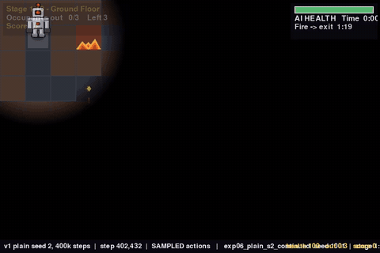

# ML findings: teaching a neural network to rescue people from a burning building

The project's game has a hand-written A* rescuer. This folder documents an
attempt to replace it with an agent trained by reinforcement learning, and
what happened. In one line: **it learned to stand still, then, with the right
penalty, to rescue about one person in five; working out why is the result.**

| A* rescues everyone (stage 5) | the learned agent, 400k steps in, mostly stands still (stage 1) |
|---|---|
|  |  |

## Read in this order

| | file | what it is | time |
|---|---|---|---|
| 1 | **[REWARD_EVOLUTION.md](REWARD_EVOLUTION.md)** | the reward function as designed, what the AI did in response, every change made and what happened next | 15 min |
| 2 | **[FINDINGS.md](FINDINGS.md)** | the full write-up: abstract, findings F1-F10 and E1-E10, predictions vs outcomes, limits, next steps | 12 min |
| 3 | [PREDICTIONS.md](PREDICTIONS.md) | predictions written *before* the later experiments, with their outcomes | 4 min |
| 4 | [METHODS.md](METHODS.md) | the environment, observation, learner, evaluation, statistics, versions | 8 min |
| 5 | [EXPERIMENT_LOG.md](EXPERIMENT_LOG.md) | the lab notebook, in order, with the mistakes | 8 min |

## The headline numbers

| | result |
|---|---|
| A* rescuer, 200 episodes over 10 stages | evacuates everyone in **86%** (95% CI 81-91); on stages 1-4, 39 of 40 fresh episodes |
| random moves / standing still | **0%** each; random play led **nobody** out in 200 episodes |
| learned agent, plain game-score reward, 3 seeds, 100k steps | **0% evacuations**; **74-91%** of episodes end standing still |
| what each ending earns under that reward | stand still **-0.6**, wander and die **-142.3**, A* **+396.5** |
| does that price list explain the training? | predicts each run's logged return within about **3 points** wherever nothing is rescued |
| a penalty for leaving occupants inside (v2) | changes stand-still and dying by the same amount: the gap stays **141.7** |
| best learned behaviour (give-up penalty, 300k steps) | leads about **22%** of occupants out during training, plateauing; full evacuation 1-5% |
| that same model on fresh episodes | leads out 15% of occupants on trained stages, **0 of 40 on an unseen stage**; A* gets 90% there |
| the policy the game would actually use (most likely action) | **11 of 12 models stand still in 100% of episodes**; none evacuates anyone (0 of 40 each) |
| training reproducibility | same seed gives an identical run, all 12 logged columns, 33 of 33 epochs |

## Figures

| | |
|---|---|
|  | **fig_reward_vs_behaviour.png** - how episodes ended over training, per reward version and seed. The central figure. |
|  | **fig_price_of_failure.png** - what each way of failing costs under each reward version, cheapest marked. |
|  | **fig_long_run.png** - the three long runs, with rescue progress. |
|  | **fig_learning_signals.png** - policy entropy and mean return for every run. |
|  | **fig_baselines.png** - A*, random and stand-still on every stage, with intervals. |
|  | **fig_engineering.png** - the throughput and reward-scale fixes. |

## Recordings (`media/`)

MP4s are the primary files (960 x 640, 30 fps, played at 2-3x, with a caption bar
showing the agent, seed, health, occupants out and score; fine to reuse in a
project video). Every clip has a `_sheet.png` contact sheet of eight stills; the
featured clips also have a looping `.gif` for reading these pages on GitHub.

| folder | what is in it |
|---|---|
| `media/baselines/` | A* on stages 1, 5, 9; random moves on stages 1, 5; standing still on stage 1. All at seed 1000. |
| `media/reward_versions/` | the **sampled** policy (how the network acts during training), two fixed seeds each, chosen before seeing the result; the outcome is in the file name. Plain reward at step 0 / 52k / 101k, then the last checkpoint of every other version. **`exp07_..._seed1001_died.mp4` and `exp04_..._seed1001_died.mp4` show the learned agent leading one occupant out before dying.** |
| `media/early_trials/` | the first learning run at step 0, 52k and 101k, recorded with the **deterministic** policy, plus A* for reference. These look identical at every checkpoint (untrained and trained networks both stand still); FINDINGS E7 explains why. |
| `experiments/<run>/videos/` | recordings made automatically during each run's training. |

## Experiments (`experiments/`)

One folder per training run: `config.json` (exact settings), **`epochs.csv`
(the epoch-versus-accuracy log)**, `evaluations.csv` (validation against A*),
`epoch_vs_accuracy.png`, the browsable `report.html`, `final_report.txt`,
`final_model.zip`, and any recordings. `data/run_summary.md` puts all runs in one
table. All runs train on stages 1-3 and validate on stage 4.

| run | reward | seed | steps |
|---|---|---|---|
| `exp01_plain_s0`, `_s1`, `_s2` | v1: game score | 0, 1, 2 | 100k |
| `exp02_abandon_s0`, `_s1`, `_s2` | v2: + abandon penalty 100 | 0, 1, 2 | 100k |
| `exp04_giveup200_s0`, `_s1` | v3: + give-up penalty 200 | 0, 1 | 100k |
| `exp05_giveup200_timeout200_s0` | v4: + give-up and timeout 200 | 0 | 100k |
| `exp03_abandon_long_s0` | v2, long | 0 | 300k |
| `exp07_giveup200_long_s0` | v3, long | 0 | 300k |
| `exp06_plain_s2_continued` | v1 seed 2, continued | 2 | 100k -> 401k |

## Data (`data/`)

| file | contents |
|---|---|
| `baselines_episodes.csv` | 600 episodes: A*, random, stand-still x 10 stages x 20 |
| `reward_accounting.csv` / `.md` | measured return of each behaviour under each reward version |
| `run_summary.csv` / `.md` | one row per training run, with the price-list consistency check |
| `behaviour_by_checkpoint.csv` | sampled behaviour of the first, middle and last checkpoint of each run: outcome mix and the share of each action |
| `common_final_test.csv` / `.md` | every final model on identical fresh-seed episodes, deterministic and sampled, next to A* |
| `freeze_diagnostic.csv` / `.md` | where the "gave up" endings happen |

`epochs.csv` columns: `epoch, timesteps, wall_seconds, episodes_total,
window_episodes, train_accuracy` (share of the last 100 episodes fully
evacuated), `died, gave_up, timeout, occupants_out, score, reward, episode_len,
epoch_episodes, epoch_accuracy, policy_loss, value_loss, entropy, approx_kl,
clip_fraction, explained_variance, learning_rate, steps_per_second`.

## Size

About 150 MB: 98 MB of `final_model.zip` files (12 x 8 MB), 35 MB of MP4s, the rest
figures, GIFs and data. If that is too heavy for the repository, the models can be
dropped or moved to Git LFS; only `common_final_test.py`, `freeze_diagnostic.py`
and re-recording need them, and each run's numbers are in its CSVs.

## Regenerating everything

```bash
python pyro_pete_game/ml/ML_Findings/scripts/collect_runs.py           # runs/ -> experiments/
python pyro_pete_game/ml/ML_Findings/scripts/reward_accounting.py      # data/reward_accounting.*
python pyro_pete_game/ml/ML_Findings/scripts/summarise_runs.py         # data/run_summary.*
python pyro_pete_game/ml/ML_Findings/scripts/behaviour_by_checkpoint.py [RUN ...]   # then --merge
python pyro_pete_game/ml/ML_Findings/scripts/freeze_diagnostic.py
python pyro_pete_game/ml/ML_Findings/scripts/common_final_test.py
python pyro_pete_game/ml/ML_Findings/scripts/record_sampled_behaviour.py
python pyro_pete_game/ml/ML_Findings/scripts/make_media.py
python pyro_pete_game/ml/ML_Findings/scripts/make_figures.py
```

`runs/` (checkpoints, live logs) is git-ignored; the scripts that need it say so.

## Honest scope

Small, easy setting (stages 1-3, validated on stage 4), one algorithm and
architecture, three seeds or fewer per setting (one for the long runs), no
hyperparameter search. These are diagnostic experiments. They show what the
reward paid for and how the agent responded; they do **not** show that
reinforcement learning cannot solve this game. Two of six pre-registered
predictions were wrong in some clause. See [FINDINGS.md](FINDINGS.md), sections 4
and 5.
