# ML findings: teaching a neural network to rescue people from a burning building

The project's game has a hand-written A* rescuer. This folder documents two
attempts to replace it with a learned agent, and what happened.

1. **Reinforcement learning from scratch** (12 runs). It learned to stand still, and
   working out why is the result: the reward paid for it.
2. **Imitation learning from A\***. Shown A*'s own decisions *and given A*'s own
   information*, the best network (with a memory of its own path) evacuates **80%** of
   300 fresh episodes against A*'s **87%**: roughly level with A* on the stages it
   trained on (84% vs 87%), **clearly behind on three it never saw (71% vs 87%)**.

| A* rescues everyone (stage 5) | the imitation-learned network rescues everyone on a stage it never trained on (stage 8) |
|---|---|
| 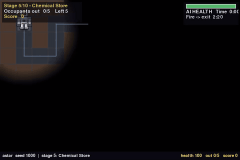 | 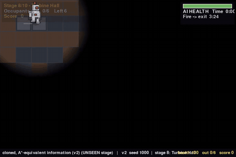 |

## Read in this order

| | file | what it is | time |
|---|---|---|---|
| 1 | **[IMITATION.md](IMITATION.md)** | the imitation-learning study: the same-conditions rule, method, results, epoch-vs-accuracy, recordings, failures | 15 min |
| 2 | **[REWARD_EVOLUTION.md](REWARD_EVOLUTION.md)** | the reward function as designed, what the AI did in response, every change made and what happened next | 15 min |
| 3 | **[FINDINGS.md](FINDINGS.md)** | the reinforcement-learning write-up: abstract, findings F1-F11 and E1-E10, predictions vs outcomes, limits (**read its correction box first**) | 12 min |
| 4 | [PREDICTIONS.md](PREDICTIONS.md) | predictions written *before* the later RL experiments, with their outcomes | 4 min |
| 5 | [METHODS.md](METHODS.md) | the environment, observation, learner, evaluation, statistics, versions | 8 min |
| 6 | [EXPERIMENT_LOG.md](EXPERIMENT_LOG.md) | the lab notebook, in order, with the mistakes | 10 min |

> **A correction that affects how to read the older documents.** They originally said
> the learned agent was "held to exactly what A\* is allowed to know". That was
> false: A* plans over the whole map and the live fire everywhere; the learner's
> first observation showed only a local window. The imitation study measures how
> much that mattered (a great deal) and enforces parity with tests.

## The headline numbers

| | result |
|---|---|
| A* rescuer, 300 episodes over 10 stages (two independent test sets) | evacuates everyone in **87%** (83-90); leads out 92% of occupants |
| **best imitation clone (v4: A*'s information + full-episode memory), deterministic** | **80%** (75-84); leads out 90%. **84% on trained stages vs A*'s 87%; 71% on unseen stages vs 87%** |
| the same without memory (v2) | 77% (72-81) |
| with only a local window (v1, first test only) | **20%** (13-29): giving it A*'s information was the dominant factor |
| paired, A* vs v4 on the same 300 episodes | A* won 25, v4 won 4 (p ~ 0.0001): **it does not match A\*** |
| what memory did (v2 to v4) | +3 points pooled (paired 15 vs 5, p ~ 0.04). The first test's +7 **did not replicate** on fresh seeds: prediction P10 falsified |
| the back-and-forth pattern (spotted by the project owner watching the clips) | A* **never** paces between two tiles; v2 paces in 19.5% of episodes, **v4 in 7.5%** (replicated on fresh seeds) |
| would removing the stalling fix it? (owner's hypothesis, exploratory) | Stalling is 47% of v2's failures but 27% of v4's, concentrated on unseen stages 8-10. Breaking each stall with A* (upper bound) lifts v2 77% to 84% but v4 only 80% to 83%; the rest is the endgame "one occupant short" give-up and stage-7 deaths (`IMITATION.md` 4.9) |
| does A*'s search order matter? (owner's efficiency question) | A* searches the nearest unseen area first. A mild lean towards the far side of the map beats it: **90.6% vs 86.0%** over 500 episodes (p ~ 0.0003, prediction P12 held on fresh seeds), fewer give-ups, but not faster and points not settled. Forcing far-first (79%) or sweeping from the exit (81%) is worse (`IMITATION.md` 4.11) |
| v5: clone of the far-side searcher (owner's request), per stage vs A* and v4 | On 300 fresh episodes: **A* 85%, v5 84%, v4 81%**. A* vs v5 not distinguishable (22 vs 18, p ~ 0.64); v5 vs v4 not established (p ~ 0.35). Trained stages 88% (v5) vs 84% (A*); **unseen stages 73% vs 87%**: the gap that remains is generalising to new mazes, not search order. Stage 7 is everyone's weak spot. Full per-stage tables: `data/stage_report.md` (`IMITATION.md` 4.12) |
| where the clone still fails | endgame give-ups one occupant short; about 40% slower than A* on big unseen mazes |
| reinforcement learning, plain game-score reward, 3 seeds, 100k steps | **0% evacuations**; 74-91% of episodes end standing still |
| what each ending earns under that reward | stand still **-0.6**, wander and die **-142.3**, A* **+396.5**; predicts each run's return within ~3 points |
| best RL behaviour (give-up penalty, 300k steps) | leads ~22% of occupants out in training; **0 of 40** in the form the game uses |
| every stage starts with the exit unreachable | locked door on **all ten**; spawn pocket 3-45 tiles of 116-319 on nine |
| training reproducibility | same seed gives an identical run, all 12 logged columns |

## Figures

| | |
|---|---|
| 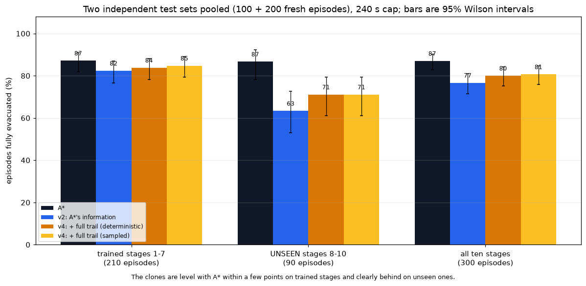 | **fig_imitation_pooled.png** - A*, v2 and v4 on two independent test sets pooled (300 episodes). The fairest picture. |
| 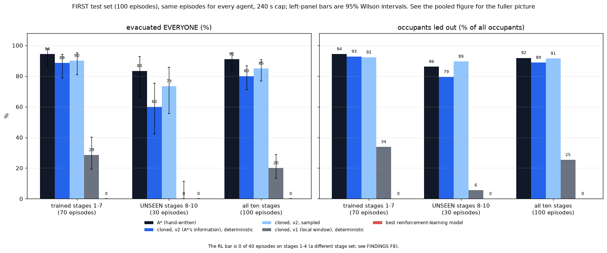 | **fig_imitation_headline.png** - first 100-episode test: clone vs A* vs the local-window clone vs RL. |
| 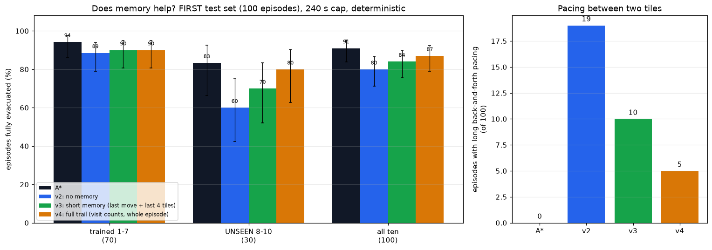 | **fig_imitation_memory.png** - memory (v2, v3, v4) on the first test set, and the pacing counts. |
| 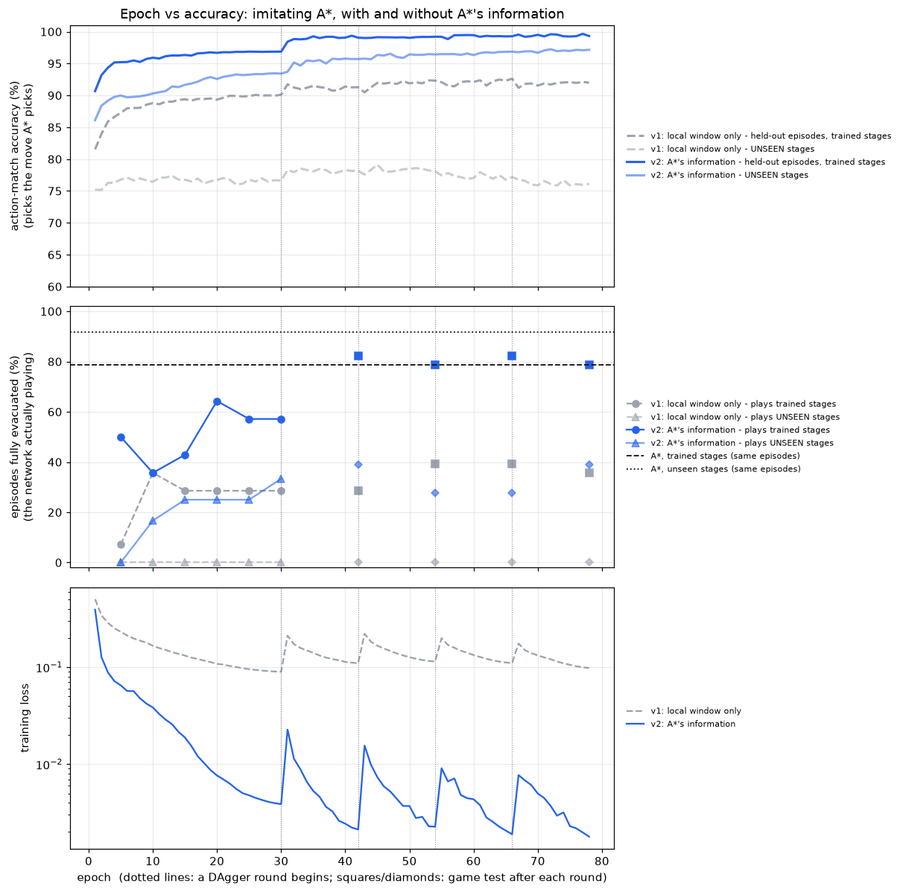 | **fig_imitation_epoch_vs_accuracy.png** - epoch vs accuracy for both imitation runs, including DAgger rounds. |
| 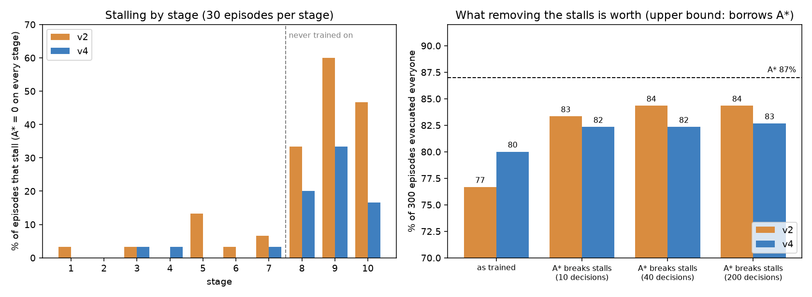 | **fig_stall.png** - where the networks stall (by stage) and what removing the stalls would be worth. |
| 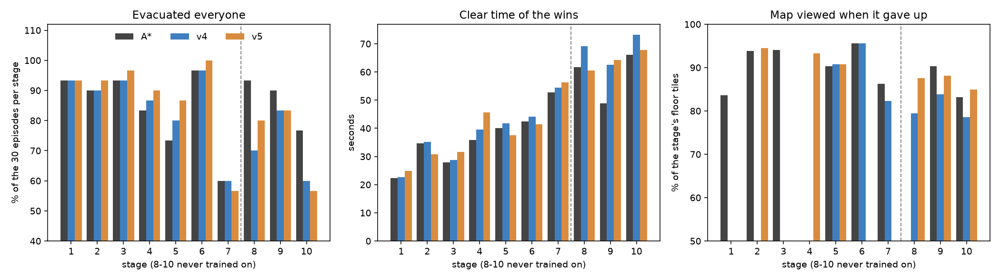 | **fig_stage_report.png** - A*, v4 and v5 stage by stage: evacuation, clear time, and how much of the map was viewed when giving up. |
| 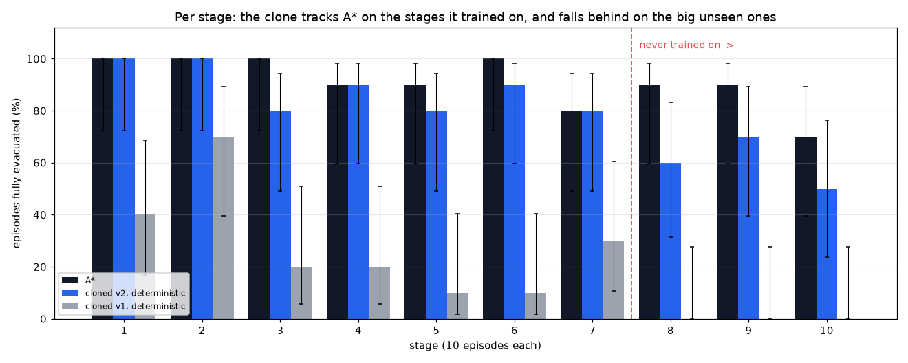 | **fig_imitation_by_stage.png** - per stage; the gap opens on the unseen mazes. |
| 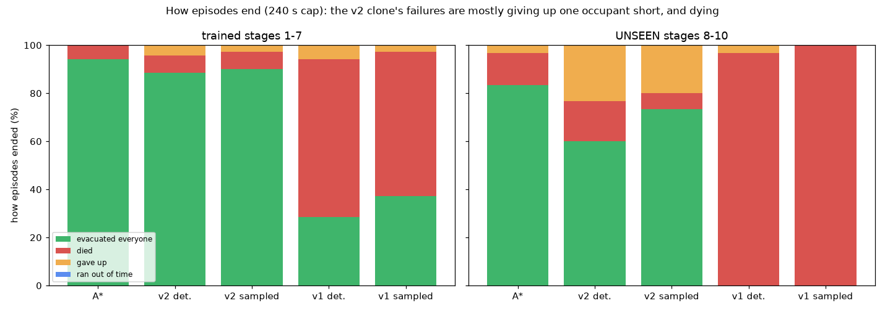 | **fig_imitation_outcomes.png** - how episodes end. |
| 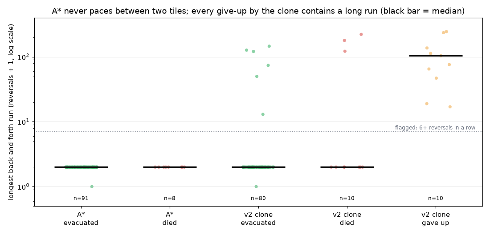 | **fig_imitation_pingpong.png** - the longest back-and-forth run per episode: A* never, the clone's give-ups always. |
|  | **fig_reward_vs_behaviour.png** - RL: how episodes ended over training, per reward version and seed. |
|  | **fig_price_of_failure.png** - RL: what each way of failing costs under each reward version. |
|  | **fig_long_run.png** - RL: the three long runs. |
| 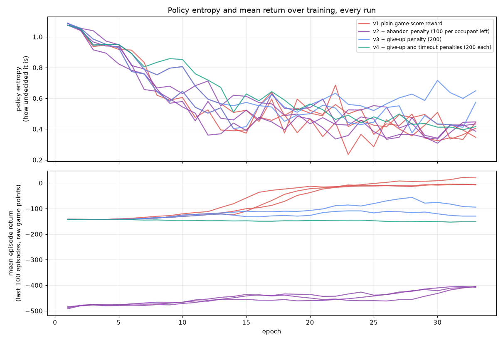 | **fig_learning_signals.png** - RL: entropy and return for every run. |
| 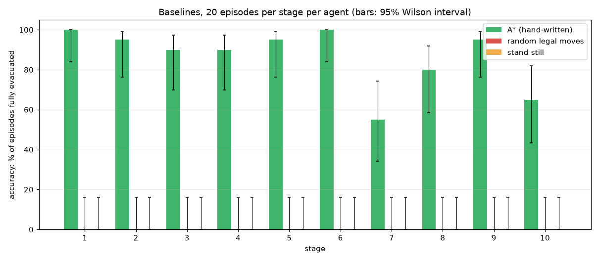 | **fig_baselines.png** - A*, random and stand-still on every stage. |
| 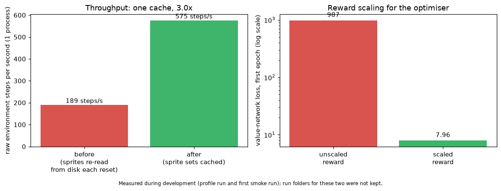 | **fig_engineering.png** - the throughput and reward-scale fixes. |

## Recordings (`media/`)

MP4s are the primary files (960 x 640, 30 fps, played at 2-4x, with a caption bar
showing the agent, seed, health, occupants out and score; fine to reuse in a
project video). Every clip has a `_sheet.png` contact sheet of eight stills; the
featured clips also have a looping `.gif` for reading these pages on GitHub.

| folder | what is in it |
|---|---|
| **`media/imitation/`** | **A\*, the A\*-information clone (v2) and the local-window clone (v1) on the same seeded episodes**, stages 1, 3, 5, 7, 8, 9, 10 (8-10 unseen), 240 s cap. Outcome in each file name; about half show the clone failing. Index with what each shows: [IMITATION.md section 5](IMITATION.md). |
| `media/baselines/` | A* on stages 1, 5, 9; random moves on stages 1, 5; standing still on stage 1. All at seed 1000. |
| `media/reward_versions/` | RL: the **sampled** policy for each reward version, two fixed seeds each, outcome in the file name. `exp07_..._seed1001_died.mp4` and `exp04_..._seed1001_died.mp4` show an RL agent leading one occupant out before dying. |
| `media/early_trials/` | the first RL run at step 0, 52k and 101k, recorded with the **deterministic** policy (these look identical at every checkpoint; FINDINGS E7 explains why), plus A*. |
| `experiments/<run>/videos/` | recordings made automatically during each RL run's training. |

## Experiments

**Imitation (`imitation/`)** - `imit_a_v1_local_view` (the network sees only a local
window) and `imit_b_v2_route_hints` (it also gets A*'s route information); identical in
everything else. Each holds `config.json`, **`epochs*.csv` (the epoch-vs-accuracy log:
30 cloning epochs then 4 x 12 DAgger epochs)**, `rounds.csv`, `baseline.json`,
`final_report.txt`, `final_results.csv`, the chart, and the trained model (about 3 MB).

**Reinforcement learning (`experiments/`)** - one folder per run: `config.json`,
**`epochs.csv`**, `evaluations.csv`, `epoch_vs_accuracy.png`, `report.html`,
`final_report.txt`, `final_model.zip` (git-ignored), and recordings.
`data/run_summary.md` puts all runs in one table. All train on stages 1-3, validate
on stage 4.

| run | reward | seed | steps |
|---|---|---|---|
| `exp01_plain_s*` | v1: game score | 0, 1, 2 | 100k |
| `exp02_abandon_s*` | v2: + abandon penalty 100 | 0, 1, 2 | 100k |
| `exp04_giveup200_s*` | v3: + give-up penalty 200 | 0, 1 | 100k |
| `exp05_giveup200_timeout200_s0` | v4: + give-up and timeout 200 | 0 | 100k |
| `exp03_abandon_long_s0` | v2, long | 0 | 300k |
| `exp07_giveup200_long_s0` | v3, long | 0 | 300k |
| `exp06_plain_s2_continued` | v1 seed 2, continued | 2 | 100k -> 401k |

## Data (`data/`)

| file | contents |
|---|---|
| `imitation_240s.csv` / `.md` | the imitation final test at a 240 s cap: A*, both clones, deterministic and sampled |
| `imitation_summary.md` | the tables in IMITATION.md (240 s primary, 90 s comparison), and where the give-ups come from |
| `confirmation_240s.csv` / `.md`, `pooled_300.md` | the fresh 200-episode confirmation test, and both test sets pooled (300 episodes) |
| `memory_summary.md` | v2 vs v3 vs v4, with the registered predictions graded by code |
| `oscillation_fresh.csv` / `.md` | the back-and-forth analysis on the fresh episodes |
| `oscillation.csv` / `.md` | the back-and-forth analysis: per-episode reversal statistics for A* and the v2 clone |
| `spawn_reachability.md` | what is reachable at spawn on each stage (the locked door) |
| `baselines_episodes.csv` | 600 episodes: A*, random, stand-still x 10 stages x 20 |
| `reward_accounting.csv` / `.md` | measured return of each behaviour under each reward version |
| `run_summary.csv` / `.md` | one row per RL run, with the price-list consistency check |
| `behaviour_by_checkpoint.csv` | sampled behaviour of the first, middle and last checkpoint of each RL run |
| `common_final_test.csv` / `.md` | every RL final model on identical fresh-seed episodes, deterministic and sampled, next to A* |
| `freeze_diagnostic.csv` / `.md` | where the RL "gave up" endings happen |

The imitation `epochs*.csv` columns: `epoch, seconds, lr, train_loss, train_acc,
val_seen_loss, val_seen_acc` (action-match on held-out episodes of trained stages),
`val_unseen_acc` (action-match on stages never trained on), `stay_recall_seen`, and
`game_seen_evac, game_seen_occ, game_unseen_evac, game_unseen_occ` (the network
playing, every 5 epochs). The RL `epochs.csv` columns are described in METHODS.md.

## Size

About 200 MB on disk, about 104 MB tracked by git: 63 MB of MP4s, and the 12 RL
`final_model.zip` files (98 MB) are **git-ignored** and stay local. The two imitation
models (about 3 MB each) are tracked. Only `common_final_test.py`, `freeze_diagnostic.py`
and re-recording need the RL models.

## Regenerating everything

```bash
# imitation
python tools/train_imitation.py --name imit_b --obs-version 2      # cloning + DAgger + final test
python tools/train_imitation.py --name imit_a --obs-version 1      # the local-window ablation
python pyro_pete_game/ml/ML_Findings/scripts/imitation_long_cap_test.py
python pyro_pete_game/ml/ML_Findings/scripts/make_imitation_figures.py
python pyro_pete_game/ml/ML_Findings/scripts/record_imitation.py
python pyro_pete_game/ml/ML_Findings/scripts/spawn_reachability.py
python pyro_pete_game/ml/ML_Findings/scripts/oscillation_analysis.py [fresh]
python pyro_pete_game/ml/ML_Findings/scripts/confirmation_test.py
python pyro_pete_game/ml/ML_Findings/scripts/pooled_summary.py
# reinforcement learning
python pyro_pete_game/ml/ML_Findings/scripts/collect_runs.py           # runs/ -> experiments/
python pyro_pete_game/ml/ML_Findings/scripts/reward_accounting.py
python pyro_pete_game/ml/ML_Findings/scripts/summarise_runs.py
python pyro_pete_game/ml/ML_Findings/scripts/behaviour_by_checkpoint.py [RUN ...]   # then --merge
python pyro_pete_game/ml/ML_Findings/scripts/freeze_diagnostic.py
python pyro_pete_game/ml/ML_Findings/scripts/common_final_test.py
python pyro_pete_game/ml/ML_Findings/scripts/record_sampled_behaviour.py
python pyro_pete_game/ml/ML_Findings/scripts/make_media.py
python pyro_pete_game/ml/ML_Findings/scripts/make_figures.py
```

`runs/` (checkpoints, live logs) is git-ignored; the scripts that need it say so.

## Honest scope

RL: small easy setting (stages 1-3, validated on stage 4), one algorithm and
architecture, three seeds or fewer per setting, no hyperparameter search; two of six
pre-registered predictions were wrong in some clause. Imitation: one training run per
observation version, 10 episodes per stage, and version 2 hands the network A*'s own
route computations, so it mostly learns *which goal to pursue*, which is far easier than
learning from a raw view. **Nothing here shows a learned agent beating A\*; the best
result matches it on the stages it trained on.** See [IMITATION.md](IMITATION.md)
section 6 and [FINDINGS.md](FINDINGS.md) sections 4 and 5.
