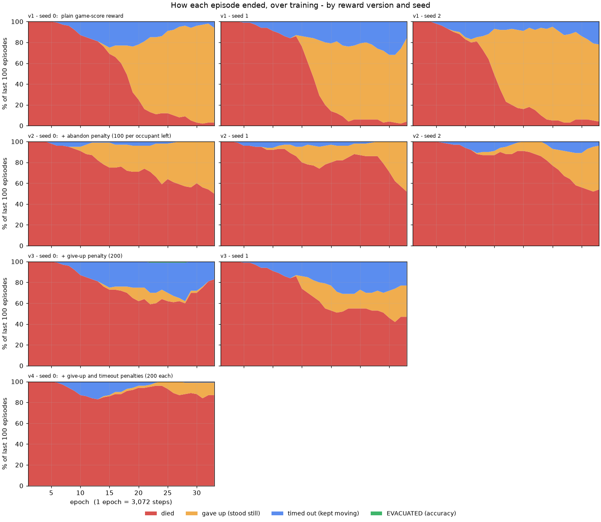
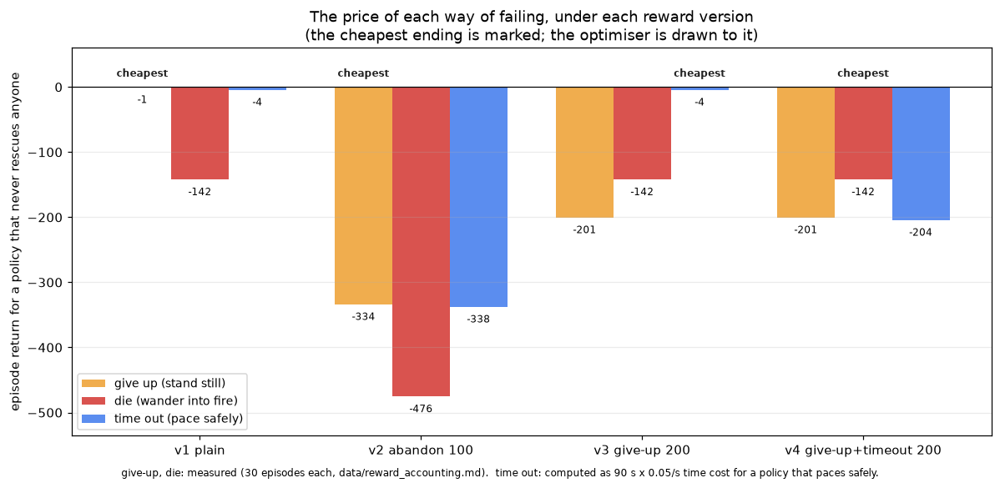
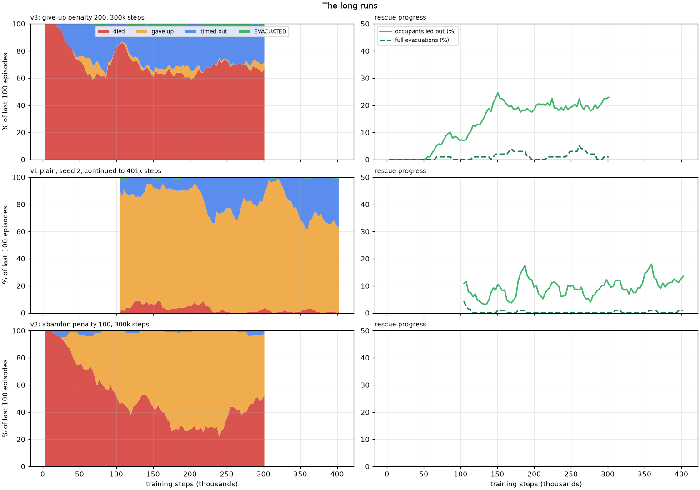

# The reward structure, and what the AI did in response

This is the core of the project's findings: how the reward function was
designed, what behaviour it produced, what was changed, and what the AI did
next. Every claim is backed by a file in this folder; the training setup is in
[METHODS.md](METHODS.md), the predictions written before the later experiments
are in [PREDICTIONS.md](PREDICTIONS.md), and the chronological notebook is
[EXPERIMENT_LOG.md](EXPERIMENT_LOG.md).

**Scope of every claim below:** a small MLP trained with MaskablePPO on
stages 1-3 (validated on stage 4), 100,000 steps per run unless stated,
three seeds per setting where stated. It says what happened in this setup. It
is not a general statement about reinforcement learning.

## At a glance

| version | change | why | AI's response (100k steps) | verdict |
|---|---|---|---|---|
| **v0** (design) | game-score reward, no shaping | mirror the score the results screen shows | *(only a 3-epoch smoke run: value loss about 987, so reward scaling was added before any real training)* | scale fixed, ordering unchanged |
| **v1** plain | + reward scaling for the optimiser | make the value network trainable | **learned to stand still**: 74-91% of episodes end by giving up; no full evacuation in any seed | collapsed to the cheapest failure it could reach |
| **v2** abandon penalty | charge 100 per occupant left inside at the end | make giving up expensive, on the theory that standing still would stop being the best option | still no rescue and still no full evacuation; the collapse changed shape (about half died, half stood still) but did not go away | did not fix it; my stated reasoning was wrong (see section 5) |
| **v3** give-up penalty | charge 200 when the AI stands still until it gives up | test the explanation: price the cheapest failure out of the market | giving up fell to 0% in seed 0 but stayed at 30% in seed 1; the collapse did **not** move to timeouts (17-23%); 83% / 47% died; seed 0 led 7.2% of occupants out, seed 1 none | prediction P3 not supported; explanation refined ("cheapest failure it can reach") |
| **v4** give-up + timeout penalties | also charge 200 for running out the clock | close the next-cheapest failure | 87% died (where it started), 12% gave up, 1% timed out, **no rescue by the end**; mean return **-151, worse than the random starting policy (-142)** | P4 held as written, but nothing moved: the policy never left dying, and it got slightly worse |
| long run | v2 for 300,000 steps | does more of the same help? | **0 rescues in all 98 epochs**; the mix drifts between 25% and 75% giving up | no: prediction P2 held (at 300k, not the 500k first planned) |
| continued | v1 seed 2, 300k more steps | that seed had started to rescue | still 62-98% giving up; occupants led out rose from 7.8% to about 12% (peak 18%); full evacuation <= 4%; return about +40 | prediction P5 held; a small income, no competence |
| **v3 long** | v3 seed 0, 300k steps | v3 was the only setting where the rescue signal grew | occupants led out **7% -> 23%**, plateauing near 20% from about 150k; full evacuation 1-5%; return -142 -> -29 | prediction P6 held; the best learned behaviour in this project, and still far from A* |



*Figure 1. How each episode ended (share of the last 100 episodes) over training.
Red died, amber stood still until the game gave up, blue kept moving until the
time limit, green evacuated everyone. There is no green in any run.*

---

## 1. v0: the initial reward

The reward was built from the game's own scoring, so that what the agent
learns to maximise is what the results screen scores (`ml/env.py`,
`RewardConfig`):

| term | value | source |
|---|---|---|
| each occupant led to the exit | **+100** | `SCORE_PER_SURVIVOR` |
| the AI reaches the exit at the end of a full evacuation | **+50** | `SCORE_REACH_EXIT` |
| speed bonus, only on a full evacuation | up to **+60**, falling to 0 at 90 s | `SCORE_TIME_BONUS_MAX`, `_PAR` |
| health lost | **-0.4** per point (100 health = -40) | `SCORE_DAMAGE_PENALTY` |
| dying | **-100**, once | added for training |
| time | **-0.05** per second of game time | added for training |
| stepping into a wall | **-0.2** | added for training |

Episodes end when the game says the stage is over (everyone out; or nobody
alive can act), when the AI stands still for **12 s** (the game's give-up rule,
which is also how the A* agent gives up), or at the time cap (90 s here).

**Design intent, written down before any training.** *No distance-to-goal
shaping*: paying the agent for "getting closer" to something invites a
policy that hovers next to the goal without finishing, and the spreading fire
already supplies time pressure. A reward that is nothing but the game score
is easy to defend: a policy that maximises it is, by construction, a policy
that plays the game well.

**The risk I flagged in advance,** when the plan was first discussed, was
sparse reward: nothing positive happens until an occupant has been led all the
way out, and random exploration might never manage that. That risk is exactly
what materialised.

### The baseline this reward is measured against

| agent, 20 episodes x 10 stages | accuracy (full evacuation) | occupants led out |
|---|---|---|
| A* (hand-written) | **86%** (95% CI 81-91) | 90% of occupants |
| random legal moves | 0% (0-2) | **0 of 200 episodes led anyone out** |
| stand still | 0% (0-2) | 0 |

(`baselines/baseline_report.txt`, `figures/fig_baselines.png`.) The reward
ceiling, an A* episode, is worth about **+397**.

### Before any behaviour change: the scale problem

The first real training run had a value-network loss of 860-990: returns are
in the hundreds of points, and the network has to predict them. Adding
running-return normalisation for the optimiser only (rewards are divided by a
running estimate of their scale before the learner sees them; observations are
untouched; logged numbers stay in real points) brought the first-epoch value
loss to about 8. This changes *how easy the reward is to fit*, not *which
behaviour scores higher*, so it is not counted as a reward version.
(`figures/fig_engineering.png`)

---

## 2. What each way of ending an episode is worth

Before looking at what the AI learned, here is what the reward *pays* for each
kind of behaviour. This was measured (`scripts/reward_accounting.py`,
`data/reward_accounting.md`): 30 seeded episodes per behaviour on stages 1-3,
through the real environment.

| behaviour | what happens | mean return | how it decomposes |
|---|---|---|---|
| **stand still** | game gives up after 12 s | **-0.6** | 12 s x 0.05 |
| **wander randomly** | dies, 100% of episodes | **-142.3** | -100 death, about -40 for 100 health burned, about -2 time |
| **A*** | evacuates 97% | **+396.5** | 3-4 occupants x 100, exit and speed bonus |
| pace safely to the time limit *(computed, not measured)* | clock runs out | about **-4.5** | 90 s x 0.05 |



The consequence is direct. **Under the plain reward, standing still beats
wandering by 141.7 points**, and a policy that paces safely would beat both.
An agent has to *succeed* at rescuing to earn anything positive, and:

* **Break-even.** Trying instead of standing still is only worth it if the
  attempt succeeds often enough: `p x 396.5 + (1-p) x (-142.3) >= -0.6`, so
  **p >= 26%**. Below that, doing nothing is the better bet.
* **Random play never succeeds.** 0 of 200 baseline episodes and 0 of 30
  accounting episodes led a single occupant out. The chance of a success
  appearing by luck is, with 95% confidence, under about 2%.

So the reward gives the optimiser a strong, immediate, reliable signal that
dying is bad and standing still is nearly free, and a signal about success
that random behaviour almost never produces.

---

## 3. v1: the plain reward, and what the AI did

**Prediction (from the design):** the agent starts by dying, learns to avoid
fire, and *hopefully* finds an occupant.

**What happened (three seeds, identical settings):**

| seed | died | gave up (stood still) | timed out | evacuated | mean return | occupants led out (final) | policy entropy |
|---|---|---|---|---|---|---|---|
| 0 | 3% | **91%** | 6% | 0% | -6 | 0.0% | 1.08 -> 0.44 |
| 1 | 4% | **80%** | 16% | 0% | -8 | 0.0% | 1.09 -> 0.35 |
| 2 | 4% | **74%** | 22% | 0% | **+20** | 7.8% | 1.09 -> 0.41 |

The story in three phases, the same in every seed (Figure 1, top row):

1. **Wander and die (epochs 1-10).** 100% of episodes end in death and the mean
   return is -142, exactly the price of wandering. The policy is nearly
   uniform over legal moves (entropy about 1.09, which is `ln 3`).
2. **Become decisive before finding anything (epochs 9-12).** Entropy drops
   below 0.6 in every run. The policy has stopped exploring long before it has
   much to be decisive about.
3. **Stand still overtakes dying (epochs 16-19, 49k-58k steps).** In all three
   seeds the share of "gave up" endings overtakes "died" within a three-epoch
   window. The mean return climbs from -142 to about -6: **the policy's return
   improved by 136 points by doing less**, and that is exactly what the
   optimiser is meant to do.

**An independent check that the price list explains this.** If the price list
in section 2 is what the optimiser responds to, then a run's logged return
should be the shares of each ending times their prices. It is:

| run | logged mean return | predicted from the price list |
|---|---|---|
| plain, seed 0 | -6 | -5 |
| plain, seed 1 | -8 | -7 |
| plain, seed 2 | **+20** | -7 |

Seeds 0 and 1 match within 1 point. Seed 2 is 27 points *above* its
prediction, because it is the one seed that is also, occasionally, rescuing
people (below). (`data/run_summary.md`.)

### The nuance I got wrong in my first prediction

I predicted no occupant would be led out at all. In fact **two of three seeds
led occupants out during training**: seed 0 in 9 of 33 epochs (peak 1.8% of
occupants) and seed 2 in 23 of 33 epochs (peak 8.5%, mean score up to 32). No
seed ever produced a *full* evacuation. So the corrected statement is not "a
success is never seen" but **"successes are rare and partial, and the penalties
that punish trying are frequent and certain."** Seed 2 is the interesting one:
its return is positive, above standing still. It may be slowly climbing out of
the trap where seeds 0 and 1 have already settled into it. That is the
question the continued run below is designed to answer.

**Verdict.** The AI did exactly what the reward paid for. Nothing was
malfunctioning: the optimiser found the behaviour with the best return that it
could reach from random exploration, and that behaviour is to do nothing. This
is a small, clean instance of what the literature calls specification gaming:
the reward, as written, ranks "give up" above "try".

---

## 4. Diagnosing it, and the wrong fix

The first instinct was that standing still costs almost nothing, so **make
giving up expensive.** Version 2 charges **100 per occupant still inside when
the episode ends**, which is faithful to the game (leaving people inside means
they are lost). My reasoning at the time was:

> If giving up costs about 300 instead of about 0, standing still stops being
> the safe option, and the policy will have to try.

## 5. v2: the abandon penalty, and why that reasoning was wrong

**What happened (three seeds):**

| seed | died | gave up | timed out | evacuated | mean return | occupants led out, any epoch | predicted return |
|---|---|---|---|---|---|---|---|
| 0 | 50% | 50% | 0% | 0% | -405 | **never (0 of 33 epochs)** | -405 |
| 1 | 52% | 48% | 0% | 0% | -405 | **never (0 of 33)** | -408 |
| 2 | 54% | 42% | 4% | 0% | -408 | **never (0 of 33)** | -411 |

The collapse to standing still was *slower and partial* (42-50% at 100k steps,
against 74-91% for v1), but the run still learned nothing about rescuing
anyone.

**Why the fix could not work the way I expected.** The abandon penalty is
charged for *every* way an episode can end with people inside. Standing still
and dying both end that way, so both get the same charge, about 333 points
(3.33 occupants on these stages). Measured:

| | stand still | wander (die) | difference | A* |
|---|---|---|---|---|
| v1 plain | -0.6 | -142.3 | **141.7** | +396.5 |
| v2 abandon | -333.9 | -475.6 | **141.7** | +383.2 |

The gap between standing still and dying, the thing that made standing still
the winner, is **exactly unchanged (141.7 in both)**. I had reasoned about the
absolute cost of giving up, and what an optimiser compares is the *difference
between the behaviours it can currently produce*. A penalty that lands equally
on the two failures does not re-rank them. What it did change is the value of
*succeeding*: relative to standing still, a full rescue is now worth
717 points instead of 397, which lowers the break-even success probability
from 26% to 16.5%. That only matters if a success is ever sampled, and in
v2 none ever was.

This is also why the return checks out so well: 50% x (-333.9) + 50% x (-475.6)
= **-404.8**, and the runs logged **-405, -405, -408**.

**What I can and cannot conclude from v2 (three seeds, 100k steps).**

* It did not break the trap, and the reasoning behind it was wrong.
* It coincided with a *slower* collapse to standing still (42-50% against
  74-91%) and with **zero rescues in 99 epochs across three seeds**, against
  rescues in two of three v1 seeds. With three seeds each I cannot say
  whether the absence of rescues is caused by the penalty, though it is
  suggestive. One untested candidate: adding a large end-of-episode charge
  raises the scale that the reward normaliser divides by, which shrinks the
  relative size of the occasional +100 for a rescue that the policy sees.
* Whether v2's mixed outcome is a stable resting place or a stage on the way
  to standing still is what the 500,000-step run shows.

---

## 6. Testing the explanation directly

The explanation I held after v1 and v2 was:

> The reward ranks the *failures the agent can currently produce*, and the
> optimiser learns the cheapest one. Changing the price of one failure moves
> the collapse to the next cheapest; it cannot create a rescue, because
> nothing in the reward leads toward one.

(v3 and v4 changed it; see "Reading v3 and v4 together" below.) It makes a
sharp, falsifiable prediction, and I wrote it down before running the
experiments ([PREDICTIONS.md](PREDICTIONS.md)):

* **v3, give-up penalty 200** makes standing still cost -200.6, *worse* than
  dying (-142.3). The collapse should move from "gave up" to the next
  cheapest ending: **timing out** (pace safely for 90 s, about -4.5).
* **v4, give-up and timeout penalties 200 each** closes that too. The
  cheapest remaining ending is **dying** (-142.3). The collapse should move
  to suicide.

If instead either version produced rescues, the explanation is wrong.

### v3 results

Two seeds, 100,000 steps, give-up penalty 200 (standing still until the game
gives up now costs -200.6, *worse* than dying at -142.3).

| seed | died | gave up | timed out | evacuated | mean return | occupants led out (final / peak) | epochs with any rescue | predicted from price list |
|---|---|---|---|---|---|---|---|---|
| 0 | **83%** | 0% | 17% | 0% | -95 | **7.2%** / 10.1% | 17 of 33 | -119 |
| 1 | 47% | **30%** | 23% | 0% | -130 | 0.0% / 0.0% | 0 of 33 | -128 |

**Against the prediction (P3):**

| clause | seed 0 | seed 1 |
|---|---|---|
| "gave up" falls to <= 10% | held (0%) | **failed** (30%, and rising from 24% at epoch 19 to 32% at epoch 31) |
| replaced by >= 50% timeouts | **failed** (17%) | **failed** (23%) |
| no occupant led out | **failed** (7.2%) | held |

**P3 is not supported.** The collapse did not move to pacing safely. Closing the
free exit did something different: in seed 0 the AI kept exploring dangerous
ground, died in most episodes, and *did* start leading occupants out (about as
much as the best plain-reward seed); in seed 1 it kept standing still in about
a third of episodes despite that being the most expensive ending on offer.

**What still held:** the price list keeps predicting the logged return. For
seed 1 it is -128 against -130 logged. For seed 0 it is -119 against -95
logged, and the 24-point gap is the rescues, which the price list does not
include.

**A refinement of the explanation, stated as a post-hoc hypothesis.** I said
the optimiser learns "the cheapest failure". The data say it learns *the
cheapest failure it can currently reach*. Standing still is reachable by
doing nothing, so under v1 the policy found it within 16-19 epochs. Pacing
safely for 90 s (about -4.5) needs a *skill* (moving around fire and smoke
without dying), which a network at 100k steps does not have; so dying, not
timing out, remains the common way to fail. This fits v1 (collapse to the
trivially reachable exit), and it explains why v3 seed 0 kept exploring
(nothing cheap was within reach) and, sometimes, found a rescue. It is not yet
tested: exp05 and exp07 are its tests.

**Variance.** Two seeds with identical settings ended at 0% and 30% giving up,
and at 7.2% and 0.0% of occupants led out. Any single-seed reading of these
runs would have been wrong about the other seed, which is the reason this
folder reports every seed and not the most flattering one.


### v4 results

One seed, 100,000 steps, give-up penalty 200 **and** timeout penalty 200. Now
the cheapest ending on offer is dying (-142.3); standing still costs -200.6
and running out the clock -204.5.

| seed | died | gave up | timed out | evacuated | mean return | occupants led out (final / peak) | epochs with any rescue | predicted from price list |
|---|---|---|---|---|---|---|---|---|
| 0 | **87%** | 12% | 1% | 0% | **-151** | 0.0% / 1.8% | 11 of 33 | -150 |

**Against the prediction (P4):** dying at least 70% of the time: **held** (87%).
Timeouts suppressed: held (1%). Still no competent rescue: held (rescues appear
briefly at epoch 11 at 1.5% of occupants, then vanish, and are 0% by epoch 21).

**But "the collapse moved to dying" is the wrong reading, and I will not claim
it.** Dying is where the policy *started*: 100% of episodes at epoch 1. It did
not move there; it never left. And the mean return got *worse* than that
random starting point, from -142 to -151. Two things in this run I cannot
explain from the data:

* **Return fell under optimisation.** An optimiser that is improving the
  return should not end below its random starting policy. The most
  likely reading is that with every cheap ending priced out and no success
  within reach, there was nothing to climb, and the run drifted; but a
  single seed cannot separate that from a problem with the learner setup.
* **"Gave up" rose to 12% (and was 15% at epoch 31)**, although it is the most
  expensive ending at -200.6, more than dying. Seed 1 of v3 did the same (30%).

**A hypothesis about that, not tested by the reward experiments.** The reward
charges damage *as it happens* (-0.4 per health point, so a burning policy is
punished on every step), while the give-up penalty arrives once, up to 12
seconds later. A policy that learns the local rule "do not move while fire is
near" avoids the immediate, frequent penalty and only pays the delayed one.
If so, the standing-still that remains is **state-dependent freezing near
fire**, not a global decision to do nothing. This is checkable: it predicts
that most "gave up" endings happen with fire within the agent's vision. **I
ran that check (section 7a) and the hypothesis is not supported:** the
give-ups happen at the spawn tile, and fire is in view no more often than it
would be for a random walker.

**What this run does show.** Pricing standing still and timeouts out did not
lead the network toward rescuing people; it left it dying, as it had been. That
is consistent with the plain statement in section 8 that penalising failures
does not create a rescue. It does **not** show that the optimiser "chooses
death"; it never chose anything else.

### Reading v3 and v4 together

The two predictions were the sharpest test of the "cheapest failure" account,
and neither came out as written (P3 not supported; P4 held only in a trivial
sense). What the four reward versions show, taken together:

1. **The price list is still the best predictor of the return** (v1-v4 logged
   returns are within a few points of it wherever no rescues occur), so
   the reward's arithmetic is not in doubt.
2. **"Cheapest failure" needs a qualifier: the cheapest failure *the agent can
   reach*.** Doing nothing is reachable at once, so v1 and v2 found it. Pacing
   safely for 90 s needs a learned skill, so when doing nothing was priced out
   (v3, v4) the agent did not slide to pacing; it kept dying, and in v3 seed 0
   it kept exploring. This is a refinement made after seeing the data, and the
   evidence for it is that v1/v2 collapse and v3/v4 do not, not a direct test.
3. **Closing the free exit may leave room for slow progress**, but this rests
   on one seed. The only run that grew a rescue signal at scale is v3 seed 0
   (7% -> 23% of occupants over 300k steps); v3 seed 1 with the identical
   setting showed none at 100k, and v4 (closing one more exit) showed none.
4. **Nothing in these versions led the agent to the full task.** Full
   evacuation was 5% at best in any training window and 0 of 40 in every final
   test, against 98% for A*.


---

## 7. More steps, and the seed that was climbing

### 7.1 The abandon penalty for 300,000 steps (v2, seed 0)

The run was planned at 500,000 steps and cut to 300,000 for time (see
[PREDICTIONS.md](PREDICTIONS.md), amendment). **0 occupants led out in all 98
epochs.** The outcome mix does not settle: giving up climbs from 44% at 100k to
75% at 218k, then falls back to 45% at 301k as dying returns to 53%. Mean return
moves between -488 and -367, ending at -421. The first 33 epochs are identical,
in every logged column, to the 100k-step run of the same seed
(`exp02_abandon_s0`).

**Prediction P2 (no rescues) held**, at 300k steps rather than 500k. More of
the same reward did not help.



*Figure 2. The three long runs. Left: how episodes ended. Right: the share of
occupants led out (solid) and of full evacuations (dashed). Only the top run
shows a rescue signal that grows.*

### 7.2 The give-up penalty for 300,000 steps (v3, seed 0)

This is the one setting where something grew. It reproduces the 100k-step v3
seed-0 run exactly for its first 33 epochs (33 of 33 rows identical), then
continues:

| steps | occupants led out (train) | full evacuations | died | timed out | mean return | sampled P(stay) |
|---|---|---|---|---|---|---|
| 101k | 7.2% | 0% | 83% | 17% | -95 | 0.57 |
| 126k | 12.8% | 1% | 73% | 23% | -69 | |
| 157k | **22.4%** | 2% | 63% | 31% | -25 | |
| 218k | 20.8% | 1% | 64% | 35% | -22 | |
| 280k | 18.5% | 2% | 67% | 28% | -39 | |
| 301k | **22.9%** | 1% | 68% | 27% | -29 | **0.49** |

Mean return improved by about 113 points from where training started (-142),
and the rescue share tripled between 100k and 157k steps, then **plateaued near
20%** for the remaining 150k steps. Full evacuation peaked at 5% of episodes and
ended at 1%.

**Prediction P6 held:** the rescue share at 300k (22.9%) is above the 100k value
(7.2%), and accuracy stays far under 20% (peak 5%). A* on the same episodes
evacuates 98%.

**What the AI learned, and what it did not.**

* **It learned part of the job, not the job.** On fresh episodes (40, stages
  1-4), the sampled policy led out 15% of occupants on the three stages it
  trained on and **0 of 40 on stage 4**, which it never trained on. A* leads
  out 100% on the trained stages and 90% on stage 4.
* **It rescues one person, rarely two.** Of its 12 rescuing episodes in that
  test, 9 led out one occupant and 3 led out two; none led out three.
* **After a rescue it does not go back.** In the recorded clip
  ([`media/reward_versions/exp07_..._seed1001_died.mp4`](media/reward_versions/))
  it finds an occupant, leads them to the exit (score 84, "Occupants out
  1/3"), then lingers at the exit while the fire spreads and dies with two
  occupants still inside, with "Exit on fire" on screen.
* **Hypotheses, not established:** (a) the policy has partly memorised the layout
  of the stages it trained on (each stage's maze is fixed), which would explain
  rescues on stages 1 and 3 and none on stage 4; (b) it has no memory of where
  the other occupants are, since the window is 11 x 11 and the network keeps no
  history, which would explain why it does not return for them. Neither has
  been isolated by an experiment.

### 7.3 Continuing the seed that had started to rescue (v1, seed 2, +300k steps)

The plain-reward seed 2 was the one run at 100k steps whose return was
positive. It was resumed from its saved model for another 300,000 steps (about
401k in total; planned for 400k more, cut for time).

**Prediction P5 held.**

| | at 100k (before) | over the continuation | at 401k |
|---|---|---|---|
| gave up | 74% | **62-98%**, never below 62% | 62% |
| timed out | 22% | 1-36% | 36% |
| died | 4% | 0-9% | 1% |
| occupants led out | 7.8% | 3-18%, last 10 epochs about 11.5% | 13.5% |
| full evacuation | 0% | at most 4% (only in the first epochs) | 1% |
| mean return | +20 | +1 to +50 | +49 |
| sampled P(stay) | 0.75 | | **0.55** |

The trap is not absolute: the rescue share rose and P(stay) came down. But
the run spent 300,000 steps mostly standing still, with a small steady income
from the minority of episodes in which it does rescue someone. The final test
on fresh seeds finds the sampled policy leading out **16% of occupants on stage
3 alone and 0 on stages 1, 2 or 4** (40 episodes each in total), which points
at the same map-specific behaviour as 7.2.

**The policy the game would use is worse.** In deterministic mode (always the most
likely action, which is what the game does) the final model **stood still in 40 of
40 fresh episodes**, and the same is true of the deterministic form of every other
model except exp07. The rescue income above comes from *sampling*. See
FINDINGS F8.

## 7a. Where do the give-ups happen? (a hypothesis that failed)

In the v4 discussion above I proposed that the standing still that survives
even a 200-point penalty is *freezing near fire*. That predicts most "gave up"
endings should happen with fire in view. I tested it
(`scripts/freeze_diagnostic.py`, `data/freeze_diagnostic.md`): 30 sampled
episodes per final model, and for those that ended by giving up, whether the
agent was still on its spawn tile and whether fire was within its vision.

| run | ended by giving up | still on the spawn tile | fire in view |
|---|---|---|---|
| v1 seed 0 | 28 of 30 | **20 (71%)** | 10 (36%) |
| v1 seed 1 | 28 of 30 | **20 (71%)** | 10 (36%) |
| v1 seed 2 | 23 of 30 | **19 (83%)** | 13 (57%) |
| v1 seed 2, continued | 20 of 30 | **20 (100%)** | 10 (50%) |
| v3 seed 1 | 4 of 30 | 4 (100%) | 3 (75%) |
| v4 | 1 of 30 | 1 (100%) | 1 (100%) |
| v3 seed 0, v3 long | 0 of 30 | | |

A random walker has fire in view after 12 s in **43%** of episodes (13 of 30),
so a give-up with fire in view 36-57% of the time is **no more often than
chance would give**. The hypothesis is **not supported**.

What the data do say is simpler: **the give-ups are at the start.** Between
71% and 100% of giving-up episodes never left the tile the AI spawned on. The
episode's first observation is nearly the same every time (a corner of the map),
so this behaves like a single learned decision, "at the start, stay", which
the network reaches early (entropy is below 0.6 by epoch 9-12) and then keeps.
That also fits the sampled action frequencies: a policy that stays 80% of the
time but still gives up in only about half its episodes must be moving in some
states and freezing hard in others.

## 7b. What changed inside the network

The share of decisions that are "stay" when each checkpoint plays with sampled
actions (`data/behaviour_by_checkpoint.csv`; 18 episodes per row):

| run | step 0 | first checkpoint after training | last checkpoint |
|---|---|---|---|
| v1 plain seed 0 | 0.36 | 0.72 (52k) | **0.77** (101k) |
| v2 abandon seed 0 | 0.36 | 0.82 (52k) | 0.80 (101k) |
| v2 abandon, long | 0.36 | 0.76 (151k) | 0.82 (301k) |
| v3 give-up seed 0 | 0.36 | 0.67 (52k) | 0.57 (101k) |
| **v3 long** | 0.36 | 0.60 (151k) | **0.49** (301k) |
| v4 both penalties | 0.36 | 0.71 (52k) | 0.80 (101k) |
| v1 seed 2, continued | | 0.75 (101k) | **0.55** (402k) |

At step 0, "stay" is 0.36 simply because it is the one action that is always
legal (walls remove moves). Every collapsed run drives it to about 0.8. The
two runs that made partial progress are the two whose stay probability came
back *down*, to 0.49 and 0.55.

---

## 8. What this teaches

1. **A reward defines a ranking over the behaviours the agent can currently
   produce, not over the behaviour you want.** The reward here was faithful to
   the game score and still paid the AI to do nothing, because "do nothing" was
   reachable and "rescue someone" was not.
2. **Episode termination is part of the reward.** The game's 12-second
   give-up rule is a free exit. Every way an episode can end has a price, and
   the agent will find the cheapest.
3. **Penalising a failure re-prices it; it does not point toward success.**
   Adding costs to failure modes is whack-a-mole unless the agent can also
   *reach* a success. (In v3 seed 0, closing the free exit coincided with a
   rescue signal that grew, so removing a cheap exit may leave room for
   progress; that is one seed.)
4. **Price the endings before training.** The measurement in section 2 takes
   about a minute and predicted the return of every 100k-step run to within
   roughly 3 points where no rescues occur. It would have shown that the plain
   reward favoured standing still before any compute was spent.
5. **Judge by behaviour, not just by the training curve.** The training log
   said "return improving, deaths falling", true and exactly what the collapse
   looks like from outside. The outcome mix (Figure 1) is what shows it.
6. **Evaluate the policy the way it will be used.** Training acts by sampling;
   the game acts by taking the most likely action. For every model here except
   one, the game's version stands still in 100% of episodes while the sampled
   version sometimes rescues. A model can look partly trained and be useless to
   ship. (FINDINGS F8.)
7. **Report the seeds you do not like.** Two seeds of the same setting gave
   0% and 30% giving up, and 7.2% and 0% of occupants led out. One seed would
   have told a confident story in either direction.

## 9. What has not been tried (proposals, each with what would count as a win)

None of these has been run. They are listed so the next experiments are
chosen deliberately.

| idea | mechanism | testable prediction |
|---|---|---|
| **Imitation warm start from A\*** | **Done: see [IMITATION.md](IMITATION.md).** A* sees more than the learner, so it needs A*'s own route information to follow it. | Result: with that information the clone evacuates 80% of fresh episodes (A* 91%), 89% on trained stages, and both deterministic and sampled policies work; with only a local window, 20%. It does not beat A*. |
| **Curriculum** | Start with a fire-free, one-occupant map so random exploration can succeed, then add hazards. | Full evacuation appears within the first 100k steps on the easy map; the difficulty steps then keep it. |
| **Potential-based shaping** | Pay for progress (for example, path distance to the exit or to the nearest unexplored frontier) in a form that provably does not change which policy is optimal (Ng, Harada and Russell, 1999). | Rescues appear without the standing-still collapse, because getting closer is now rewarded. Risk: a poor potential can still be exploited. |
| **Exploration bonus** | Reward visiting new tiles. | The AI leaves the spawn and finds occupants; the standing-still share falls. Risk: pacing the map forever. |
| **Make giving up not free** | Remove the 12-second give-up rule during training, or charge more for it than for dying. | Standing still stops being the cheapest ending, but by section 6 the collapse should move to the next cheapest one, so this alone should *not* produce rescues. Useful as a control. |
| **Memory (recurrent policy)** | The network sees only an 11 x 11 window and has no memory of where it has been or where the other occupants are. | Would address the "rescues one person, then lingers" behaviour of section 7.2; helps only after rescues are being found. |
| **Hold-out more than one stage during training** | The best model found rescues only on stages it trained on and none on the unseen one (0 of 40). | Adding more, and more varied, training stages should narrow the trained-vs-unseen gap if the cause is map memorisation. |
| **Larger entropy coefficient** | The policy became decisive (entropy below 0.6) by epoch 9-12, before finding anything. | A higher coefficient delays the commitment; whether that helps or just delays the collapse is unknown. |
| **Sample, don't take the most likely action, at play time** | Every model here rescues only when sampling. | A one-line change (`SB3Policy(deterministic=False)`) shows what the sampled v3-long model would do in the game; expect a weak AI, not a good one. |

## 10. Reward code by version

```python
# ml/env.py  RewardConfig (defaults = v1)
occupant     = 100.0        # per occupant led out
exit_bonus   = 50.0         # + time bonus (0..60), on a full evacuation
damage       = 0.4          # per health point lost
death        = 100.0
time_per_second = 0.05
invalid_move = 0.2
abandon      = 0.0          # v2: 100.0  per occupant not out when the episode ends
give_up      = 0.0          # v3: 200.0  when the AI stood still until the game gave up
timeout      = 0.0          # v4: 200.0  when the time limit ran out
```

Run flags: `--abandon-penalty`, `--give-up-penalty`, `--timeout-penalty`. The
exact settings of every run are in `experiments/<run>/config.json`.
